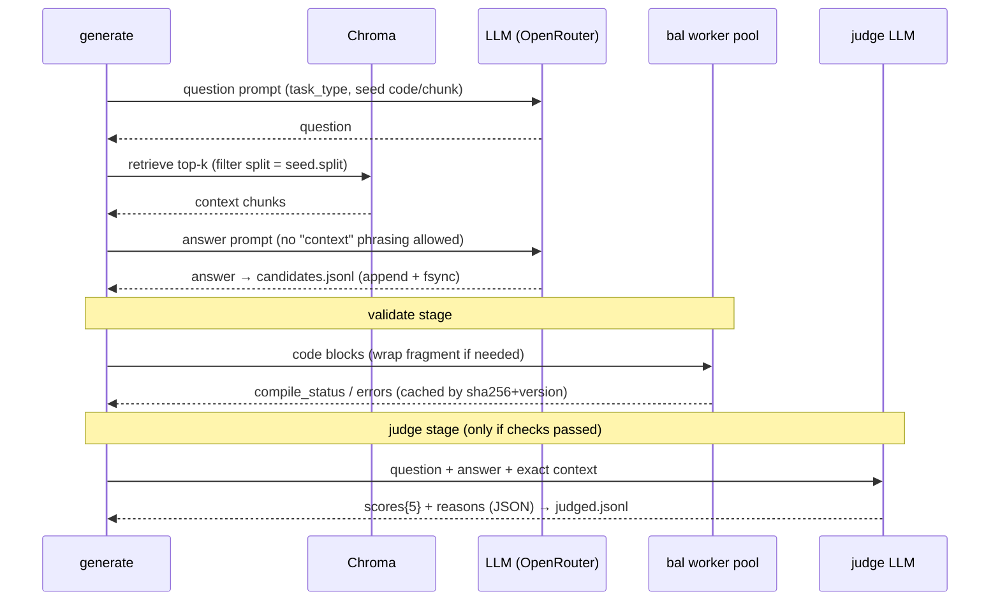
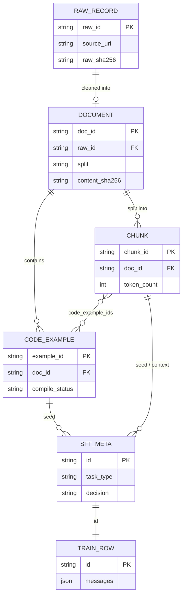

# Ballerina SFT Data Pipeline: Architecture

This pipeline builds a traceable, compiler-checked supervised fine-tuning (SFT) dataset for a Ballerina small language model (SLM). Data quality, correct code and traceability matter more than volume.

Design references: [docs/recommendations.md](docs/recommendations.md) (the reasoning) and [docs/schemas.md](docs/schemas.md) (every record and field).

> **Status:** implemented in Phase 5 (see [CHANGELOG.md](CHANGELOG.md)). Commands below are the real interface.

---

## 1. Principles

1. **Source first.** Pull clean upstream files (GitHub repos, the Central API) before scraping HTML. The HTML crawl only covers sites that have no source files.
2. **Raw data is never modified, everything else can be rebuilt.** `data/raw` is append-only. Every other folder can be deleted and regenerated from it.
3. **One stage, one output, one manifest.** Stages communicate only through files that follow the schemas. No stage holds state another stage needs in memory.
4. **Idempotent and resumable.** IDs are computed from content. A stage skips work whose output already exists, and a crash loses at most the item in progress.
5. **Verify instead of trusting.** Compile Ballerina code, score answers with a judge from a different model family, and keep every score and reason.
6. **Traceable end to end.** Any training record links back to `seed → chunk → document → raw → commit SHA or URL + fetch time`.

---

## 2. End-to-end data flow

```mermaid
flowchart LR
    subgraph SRC["Upstream sources (allowlist)"]
        GH[("GitHub<br/>ballerina-distribution/examples<br/>ballerina-dev-website<br/>module-ballerina(x)-*")]
        CEN[("Central registry API")]
        WEB[("blog.ballerina.io<br/>(sitemap)")]
    end

    subgraph SCRAPER["scraper/ — collect"]
        C1[collect github]
        C2[collect central]
        C3[scrapy crawl web]
    end

    subgraph GEN["sft-dataset-generator/"]
        CL[clean]
        EX[extract]
        CH[chunk]
        IX[index / embed]
        GQ[generate]
        VA[validate]
        JU[judge]
        EP[export]
    end

    GH --> C1
    CEN --> C2
    WEB --> C3
    C1 & C2 & C3 --> RAW[/"data/raw/**/*.jsonl.gz<br/>RawRecord"/]
    RAW --> CL --> DOC[/"data/clean/documents.jsonl<br/>Document"/]
    DOC --> EX --> CE[/"data/clean/code_examples.jsonl<br/>CodeExample"/]
    DOC --> CH --> CK[/"data/chunks/&lt;chunker&gt;/chunks.jsonl<br/>Chunk"/]
    CE -. "code_example_ids" .-> CH
    CK --> IX --> VDB[("Chroma<br/>bal__&lt;model&gt;__&lt;chunker&gt;")]
    CK & CE --> GQ
    VDB -- retrieve --> GQ
    GQ --> CAND[/"data/sft/&lt;run&gt;/candidates.jsonl"/]
    CAND --> VA --> VAL[/"validated.jsonl"/] --> JU --> JDG[/"judged.jsonl"/]
    JDG --> EP
    EP --> OUT[/"train.jsonl · eval.jsonl<br/>(messages) + metadata.jsonl"/]
```



**One deliberate change in order:** the brief lists *judge → validate*. This pipeline runs **validate → judge** instead. The compiler and the static checks are free and deterministic, so candidates that don't compile, that mention "the context", or that use unknown APIs are rejected *before* any judge tokens are spent. Nothing else changes: both checks still run, and both results are stored on every record.

---

## 3. Components

| # | Stage | Project · module | Command | Reads | Writes | Main logic |
|---|---|---|---|---|---|---|
| 1a | Collect GitHub | `scraper` · `collectors/github.py` | `python -m ballerinascraper.collect github` | GitHub API, shallow clones pinned to a commit SHA | `data/raw/github/<run>/` | Repo allowlist in YAML. File globs (`*.md`, `*.bal`, `*.metatags`, `*.out`, `index.json`). License from the repo API. |
| 1b | Collect Central | `scraper` · `collectors/central.py` | `python -m ballerinascraper.collect central` | `api.central.ballerina.io/2.0/registry/packages` | `data/raw/central/<run>/` | Paged listing of the configured orgs (`ballerina`, `ballerinax`). Readme Markdown, license, version. |
| 1c | Crawl web | `scraper` · Scrapy `SitemapSpider` | `scrapy crawl web` | `blog.ballerina.io/sitemap.xml` (27 URLs) | `data/raw/web/<run>/` | Obeys robots.txt. One honest user-agent. AutoThrottle. ETag and conditional GET. |
| 2 | Clean | `sftgen.clean` | `sftgen clean` | raw | `data/clean/documents.jsonl` | Extractor chosen by `media_type`/source: `bbe_markdown`, `nextjs_data`, `trafilatura_md`, `central_readme`, `bal_source`. Labels the language of each code block. Exact and MinHash dedup. Relevance check and `doc_type`. Assigns `split`. |
| 3 | Extract | `sftgen.extract` | `sftgen extract` | documents | `data/clean/code_examples.jsonl` | Pairs code with prose (`bbe_directive`, `md_adjacent`, `doc_comment`). Compiles each example, and runs it against `.out` where the upstream flags say it should match. |
| 4 | Chunk | `sftgen.chunk` | `sftgen chunk` | documents, code examples | `data/chunks/<chunker>/chunks.jsonl` | Splits along headings with a token budget. Never splits a code block. Adds the heading breadcrumb as a header. |
| 5 | Index | `sftgen.index` | `sftgen index` | chunks | Chroma (`data/chroma/`) | Batched embedding. `upsert` by `chunk_id`. Collection named by embedding model and chunker version. |
| 6 | Generate | `sftgen.generate` | `sftgen generate` | chunks, code examples, Chroma | `data/sft/<run>/candidates.jsonl` | Fills the per-task-type quotas. Uses grounded LLM answers, mutation (`debug_fix`), back-translation (`convert_from_language`) or the verified seed code itself (`complete_code`). Retrieval is limited to the seed's split. |
| 7 | Validate | `sftgen.validate` | `sftgen validate` | candidates | `data/sft/<run>/validated.jsonl` | `bal build --offline` in a worker pool (threads driving `bal` subprocesses), with a sandboxed temp directory per build, a timeout, a heap cap and a cache. Flags mentions of "the context". Flags unknown `module:symbol`s. |
| 8 | Judge | `sftgen.judge` | `sftgen judge` | validated.jsonl | `data/sft/<run>/judged.jsonl` | Rubric judge (1–5 on five criteria, JSON output) from a different model family. |
| 9 | Export | `sftgen.export` | `sftgen export` | judged.jsonl | `train.jsonl`, `eval.jsonl`, `metadata.jsonl` | Applies thresholds from the config. Near-duplicate filter on question embeddings. 13-gram decontamination against eval. Writes `messages` JSONL. |
| — | Shared | `shared/balpipe_common` | — | — | — | Pydantic schemas, config loading, JSON logging, atomic JSONL I/O, manifests, ID helpers. |

`sftgen all` runs stages 2–9 in order. Each stage can also be run on its own.

### Collaboration inside generate → validate → judge (one item)



---

## 4. Lineage of records



---

## 5. Where data is stored

Everything under `data/` is gitignored. GCS mirroring of raw parts to `gs://$GCS_BUCKET/<same path>` is **opt-in** (`gcs_mirror: true` + `pip install -e "shared[gcs]"`).

```
data/
├── raw/                                   # immutable, append-only
│   ├── github/<run_id>/part-00000.jsonl.gz
│   ├── central/<run_id>/part-00000.jsonl.gz
│   ├── web/<run_id>/part-00000.jsonl.gz
│   └── <source>/<run_id>/_manifest.json
├── clean/
│   ├── documents.jsonl
│   ├── code_examples.jsonl
│   └── _manifest.json
├── chunks/<chunker_name-version>/
│   ├── chunks.jsonl
│   └── _manifest.json
├── chroma/                                # derived index — safe to delete & rebuild
├── sft/<run_id>/
│   ├── candidates.jsonl                   # generate output (append-only checkpoint)
│   ├── validated.jsonl · judged.jsonl     # validate / judge checkpoints
│   ├── metadata.jsonl                     # export: all candidates + checks + scores + decision
│   ├── train.jsonl · eval.jsonl           # export: {id, messages} only
│   └── _manifest.json
└── cache/
    ├── llm/                               # response cache keyed by sha256(model+prompt+params)
    ├── compile/                           # keyed by sha256(code)+ballerina_version
    └── http/                              # Scrapy HTTPCACHE for dev runs
```

---

## 6. Repo folder structure (Option A, approved)

```
ballerina-sft-dataset-pipeline/
├── README.md · ARCHITECTURE.md · architecture.html · CHANGELOG.md · LICENSE
├── .env.example                       # secrets + model names only
├── config/pipeline.yaml               # non-secret settings
├── docs/
│   ├── recommendations.md · schemas.md
│   └── schemas/*.json                 # generated from the pydantic models
├── shared/
│   ├── pyproject.toml                 # package: balpipe_common
│   └── balpipe_common/
│       ├── schemas.py   config.py   logging.py
│       ├── jsonl_io.py  manifest.py  ids.py
│       └── tests/
├── scraper/
│   ├── requirements.txt               # minimal, pinned
│   └── ballerinascraper/
│       ├── scrapy.cfg
│       ├── ballerinascraper/
│       │   ├── settings.py  pipelines.py  raw_sink.py   # RawRecord writer
│       │   ├── spiders/web.py                        # SitemapSpider
│       │   ├── collectors/github.py  collectors/central.py
│       │   └── collect.py                            # CLI entry
│       └── tests/
├── sft-dataset-generator/
│   ├── requirements.txt
│   ├── src/sftgen/
│   │   ├── cli.py
│   │   ├── clean/ (extractors.py, fence_lang.py, dedup.py, relevance.py)
│   │   ├── extract/ (pairing.py)
│   │   ├── chunk/ (markdown_chunker.py)
│   │   ├── index/ (embedder.py, chroma_store.py)
│   │   ├── generate/ (tasks.py, mutation.py, llm.py)
│   │   ├── validate/ (bal_compiler.py, static_checks.py)
│   │   ├── judge/ (rubric.py)
│   │   ├── export/ (exporter.py, decontam.py)
│   │   └── prompts/*.yaml                         # versioned prompts
│   └── tests/
└── data/                              # gitignored, see §5
```

---

## 7. Configuration

There are two layers, read once at startup and checked by `pydantic-settings`. A missing or invalid value fails fast, with a clear message, before any work starts.

| Layer | File | Contains | Committed? |
|---|---|---|---|
| Secrets and model choice | `.env` (template `.env.example`) | `OPENROUTER_API_KEY`, `GITHUB_TOKEN`, `QUESTION_GEN_MODEL`, `ANSWER_GEN_MODEL`, `JUDGE_MODEL`, `EMBEDDING_MODEL`, `LLM_BASE_URL`, `GCS_BUCKET` (optional) | No (only the template) |
| Pipeline settings | `config/pipeline.yaml` | Source allowlists (repos, Central orgs, sitemaps), crawl politeness, chunk token budget, task quotas, judge thresholds, eval fraction, concurrency and RPM limits, Ballerina version | Yes |

Precedence: **environment variable > `.env` > `pipeline.yaml` > code default**. Any YAML key can be overridden with `BALPIPE__SECTION__KEY=value`.

Startup checks:

- Required keys must be present.
- `JUDGE_MODEL`'s model family must differ from `ANSWER_GEN_MODEL`'s. This produces a warning, or an error if `strict: true`.
- `chunk.max_tokens` must be ≤ the embedding model's `max_seq_length`.
- `bal` must be on `PATH` when `validate.enabled` is true.

Secrets are never logged. Manifests store a **redacted** config snapshot and its hash.

---

## 8. How to run

```bash
# one-time setup
python3.11 -m venv .venv && source .venv/bin/activate
pip install -e shared -r scraper/requirements.txt -e scraper \
            -r sft-dataset-generator/requirements.txt -e sft-dataset-generator -r requirements-dev.txt
cp .env.example .env            # fill in keys + model names
bal version                     # Ballerina on PATH (validated against 2201.14.x)

# collect
python -m ballerinascraper.collect github
python -m ballerinascraper.collect central
(cd scraper/ballerinascraper && scrapy crawl web)

# process + generate
sftgen clean && sftgen extract && sftgen chunk && sftgen index
sftgen generate --run-id auto   # prints the run id
sftgen validate --run-id <id> && sftgen judge --run-id <id> && sftgen export --run-id <id>

# or everything after collect
sftgen all
```

Useful flags: `--limit N` for a small test run, `--dry-run` to show the plan without calling any model, `--force` to ignore existing outputs for that stage, and `--log-format text|json`.

---

## 9. Resuming after a failure

| Mechanism | How it works |
|---|---|
| **Stage manifest** | `_manifest.json` is written with `status: running` at start, and `completed` or `failed` at the end. Re-running a stage whose last manifest isn't `completed` **resumes the same run**, provided the hashes of its inputs haven't changed. |
| **Item checkpoints** | Long stages (generate, validate, judge) append one JSONL line per finished item and flush it immediately. On resume they load the IDs already written and skip them. |
| **Atomic batch outputs** | Batch stages (clean, chunk, export) write to `*.jsonl.tmp` and `rename` it when done, so a half-written file is never read. |
| **Deterministic IDs + `upsert`** | Re-running index or extract produces identical IDs, so there are no duplicate vectors or records. |
| **Caches** | LLM responses (keyed by model, prompt and params) and compile results (keyed by code hash and Ballerina version) are cached on disk. A resumed or repeated run pays for no work that's already been done. |
| **Item-level failures** | One failed item (an LLM error after retries, a compile timeout) is recorded under `manifest.errors` with its ID and skipped. It doesn't stop the run. Re-running the stage retries them, because only finished items are skipped. |
| **Raw is immutable** | Any later stage can be deleted and rebuilt from `data/raw`. Chroma can always be rebuilt with `sftgen index --force`. |

---

## 10. Reliability, politeness and safety

| Concern | Approach |
|---|---|
| Scraping politeness | `ROBOTSTXT_OBEY=True`. One honest user-agent with a contact URL. AutoThrottle, at most 2 concurrent requests per domain, ETag and conditional GET, sitemap-driven seeds. No proxies, no user-agent rotation. |
| HTTP retries | Scrapy `RETRY_TIMES=3` with backoff. `urllib3.Retry` for GitHub and Central, honouring `Retry-After` and GitHub's `X-RateLimit-Reset`. |
| LLM calls | OpenAI SDK pointed at OpenRouter: `max_retries` with exponential backoff and `Retry-After`. No retries on 400 or 401. An `asyncio.Semaphore` plus a requests-per-minute limiter for each model. Responses must be JSON, checked against a Pydantic model. |
| Compiling generated code | Compile only, never run. A fresh temp directory as the working folder, `--offline` after a one-time warm-up, a timeout of 60 s, `JAVA_OPTS=-Xmx1g`, and 4 parallel builds. |
| Logging | Structured JSON logs (stdlib `logging`) with `run_id`, `stage`, item ID and event fields. Funnel counts go to the manifest. |
| Secrets | Only in `.env` or the environment, gitignored. Redacted in logs and manifests. Not passed to subprocesses. |
| Licensing | Every record carries an SPDX license and how it was determined. Export can filter with `allowed_licenses`. |
| Contamination | The train/eval split is made per document. Retrieval is limited to the seed's split. Export checks 13-gram overlap. |

---

## 11. Extending

- **New source:** add a collector that writes `RawRecord`s, and an extractor registered for its `media_type` or source. The downstream stages don't change.
- **New task type:** add a prompt YAML, a quota in `pipeline.yaml`, and an entry in `generate/tasks.py`. Its validation policy (`code_validation.required`) is declared alongside it.
- **New embedding model or chunker:** change the config. A new Chroma collection is created automatically, and the old one stays for comparison, using recall@k on the eval set of question→seed pairs.
