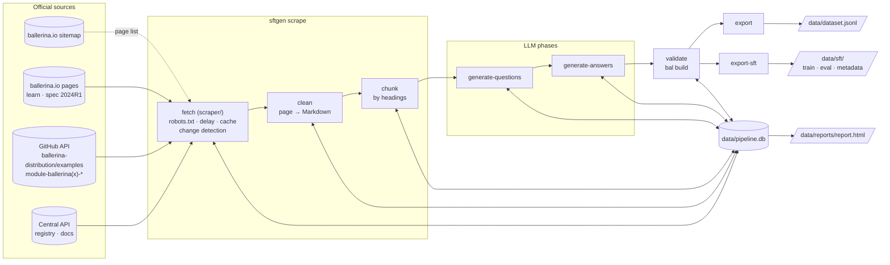
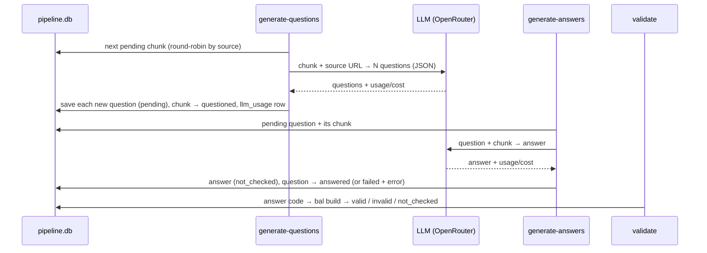
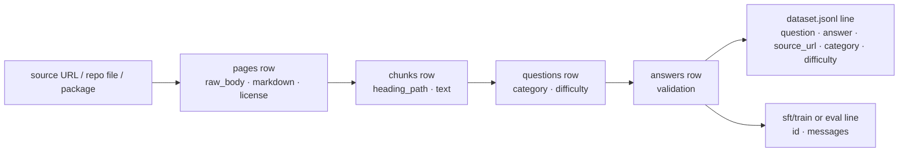

# Ballerina SFT Data Pipeline: Architecture

This pipeline builds a grounded question-and-answer dataset for fine-tuning a small language model
on Ballerina. It scrapes official sources, generates questions from heading-aware chunks, answers
each question from the same chunk, optionally compiles the code, and tracks every step in one
SQLite database with an HTML report.

References: [docs/schemas.md](docs/schemas.md) (tables, columns, statuses) ·
[CHANGELOG.md](CHANGELOG.md) (what changed in 2.1.0 and why) ·
[docs/recommendations.md](docs/recommendations.md) (research behind the v2 design).

---

## 1. Principles

1. **Official sources only.** ballerina.io (learn, by-example, spec 2024R1), Ballerina Central and the
   `ballerina-platform` GitHub org. Prefer source files and JSON APIs over rendered HTML when they
   are the more faithful copy.
2. **Grounded and cited.** A question is generated from one chunk; its answer is generated from the
   question plus that same chunk, must not invent APIs, and ends with `Source: <url>`.
3. **Every record has a status.** Pages, chunks, questions, answers and runs move through explicit
   statuses with timestamps, so progress is visible and the next run knows where to start.
4. **Small runs first.** Limits in `.env` bound each run; they are printed at startup and stored on
   the run. Re-runs never repeat finished work.
5. **Verify where possible.** Answer code is compiled with the real `bal` toolchain.
6. **Simple to operate.** One CLI, one database file, one self-contained HTML report.

---

## 2. End-to-end data flow



---

## 3. Components

| Component | Where | Responsibility |
|---|---|---|
| Config | `shared/balpipe_common/config.py` | Typed settings: `.env` (secrets, models, limits) > `pipeline.yaml` > defaults; `BALPIPE__` overrides |
| Store | `shared/balpipe_common/db.py` | SQLite schema, inserts/updates with timestamps, `run()` context that records limits, counts, duration and outcome |
| Polite HTTP | `scraper/.../collectors/http.py`, `robots.py` | User-Agent, delay, retries, rate-limit waits, robots.txt, conditional GET, listing cache |
| Collectors | `scraper/.../collectors/` | `ballerina_io` (sitemap filter, learn + spec pages), `github` (BBE bundles, module repos), `central` (registry + docs API) |
| Fetch loop | `scraper/.../scrape.py` | Per-source limit, cached/unchanged/updated/failed decisions, failure recording |
| Clean | `sftgen/clean/extractors.py`, `stage.py` | One extractor per page shape → title + Markdown; empty and duplicate pages marked |
| Chunk | `sftgen/chunk/` | Heading-aware chunks within a token budget; code blocks never split; unchanged chunks kept on re-chunk |
| Questions | `sftgen/generate/questions.py` | Round-robin over chunks, `QUESTIONS_PER_CHUNK` each, stop at `LIMIT_GENERATING`, dedup, save each |
| Answers | `sftgen/generate/answers.py` | Question + chunk → answer with citation; `answered` / `failed` |
| LLM client | `sftgen/generate/llm.py` | OpenAI-compatible async client, rate limit, retries, disk cache, tokens + cost |
| Validate | `sftgen/validate/` | Compile answer code; `valid` / `invalid` / `not_checked`. `bal_compiler` also builds multi-file packages and compiles (or, with `answers.run_tests`, runs) tests |
| Verified answers | `sftgen/generate/responses.py`, `sftgen/validate/answer_check.py`, `prompts/prompt_answer*.yaml`, `answer_judge.yaml` | `answer-prompts`: the teacher answers each accepted prompt under the answer-format contract; checks (format, `bal` build of every block / `// file:` package, tests compiled or run, judge for prose); repairs with the real errors up to 3 attempts; `attempts`, `responses`, `preference_pairs`; `data/answers/<set>/` |
| Export | `sftgen/export/stage.py` | `dataset.jsonl` (5 fields, for review), invalid answers left out |
| SFT export | `sftgen/export/sft.py` | `data/sft/train.jsonl`, `eval.jsonl` (chat `messages`), `metadata.jsonl`; split by source page; `Source:` line removed |
| Report | `sftgen/report.py` | Terminal summary + single-file HTML report |
| Source pins | `shared/balpipe_common/lock.py`, `config/sources.lock.json` | One Swan Lake update: BBE at its release tag, module repos at a locked commit, Central packages at the newest version built for the pin |
| Knowledge graph | `shared/balpipe_common/graph.py`, `sftgen/graph/coverage.py`, `graph/graph.json` | Load and validate the graph with the pinned `ballerina_graph` package; match item sources to scraped pages and spec sections; coverage in the report |
| Repo collector | `scraper/.../repos.py`, `shared/balpipe_common/licences.py`, `dedup.py` | `collect-repos`: list groups, licence pre-gate, pin with `git ls-remote`, blobless sparse clone, LICENSE-text gate, licence register, Swan Lake classification, exact + MinHash dedup across repos |
| Eval set v2 + baselines | `sftgen/eval/benchmarks.py`, `tasks.py`, `runner.py` | `eval fetch` (HumanEval, MBPP: pinned, licence-checked), `eval translate` (teacher → Ballerina task + `bal` tests, repaired), `eval tasks` (eval-split codebase tasks, BBE prompts), `eval ecosystem` (tasks per core node), `eval run` (k samples per item per model, scored with `bal` / judge, unbiased pass@k per suite and per graph item); code executed only with `eval.run_tests` |
| Eval set | `sftgen/eval/bbe.py`, `sftgen/eval/verify.py` | `build-eval`: pin BBE at the Swan Lake tag, split 30/70 by example name, tag eval items with `node#item`, check them with `bal run` (output vs `.out`) or `bal build`, fingerprint their code, write `data/eval/<version>/` |
| Prompt planner | `sftgen/plan/planner.py` | Items in scope (`prompts.nodes`), budgets by priority, slots over task mix × the item's difficulties, open slots and gap-fill rounds |
| Retrieval | `sftgen/retrieval/fts.py`, `symbols.py`, `grounding.py` | FTS5 (BM25) over chunks; Central symbol table parsed from the API reference; per-item grounding: own sources (pages or collected repo files), symbols, node sources, FTS neighbours; eval overlaps excluded |
| Prompt writer/reviewer | `sftgen/generate/prompts.py`, `prompts/prompt_writer.yaml`, `prompt_reviewer.yaml` | `generate-prompts`: DeepSeek writes prompts per item; filters (source references, near-duplicates, eval overlap); a judge of another family scores them; `data/prompts/<set>/` |
| Raw corpus + miner | `sftgen/corpus/raw.py`, `miner.py` | `corpus`: kept Swan Lake `.bal` files from licence-safe repos, decontaminated, generated code weighted 0.3, gzipped parts + manifest + ATTRIBUTION.md, register totals; `mine-fixes`: blobless full-history clones, fix-like commits (message, size, no bots), before/after pairs, decontaminated, `fixes.jsonl` |
| Codebase pool | `sftgen/codebases/pool.py`, `states.py`, `attach.py`, `stage.py` | `codebases build`: candidates from collected repos, rank, base must build, tag with graph nodes and items, train/eval split; deterministic states (compile error, unfinished feature, version drift, failing test) verified with `bal`; `codebases verify`; `codebases attach`: codebase-task prompts with the project packed in (~14k tokens) |
| Decontamination | `shared/balpipe_common/decontam.py` | Flag chunks, questions and repo files that copy eval code (exact, MinHash, shingle containment) in `eval_overlap`; held-out chunks get no questions; exports leave overlaps out and re-check their files |
| Storage switch | `shared/balpipe_common/storage.py` | `LOCAL_DATA_DIR` is the working copy; with `STORAGE_BUCKET=true` it is mirrored to GCS or S3 (fsspec) with the same layout: restore a missing database, upload changed outputs after each phase, gzipped database snapshots |

### One question, end to end



---

## 4. Lineage of records



Every dataset line can be traced back: `source_url` → `pages.url`, and the database keeps the
chunk text each answer was grounded in.

---

## 5. Where data is stored

| Path | What | Rebuildable? |
|---|---|---|
| `data/pipeline.db` | All pages (with raw cache), chunks, questions, answers, runs, LLM usage | Pages can be re-scraped; questions and answers cost money to regenerate (but see the cache) |
| `data/cache/http/` | Listing responses (sitemap, repo lists, trees, package lists), 24 h | yes |
| `data/cache/llm/` | Every model response, by hash of model + prompt + params | yes (paid) |
| `data/cache/bal/` | Compile results by code hash + Ballerina version | yes |
| `data/dataset.jsonl` | The exported dataset (review format) | yes, from the database |
| `data/sft/` | `train.jsonl`, `eval.jsonl` (chat `messages`), `metadata.jsonl` | yes, from the database |
| `data/reports/report.html` | The report | yes, `sftgen report` |
| `data/repos/` | `<owner>__<repo>@<sha12>.tar.gz` sparse snapshots of collected repos | yes, `collect-repos --refresh` |
| `data/prompts/<set>/` | `accepted.jsonl`, `rejected.jsonl`, `coverage.json` | yes, from the database |
| `data/answers/<set>/` | `sft.jsonl` (chat messages), `pairs.jsonl` (DPO), `failed.jsonl` | yes, from the database |
| `data/corpus/<version>/` | `part-*.jsonl.gz`, `manifest.json`, `ATTRIBUTION.md`, `fixes.jsonl` | yes, `corpus` / `mine-fixes` |
| `data/cache/mine/` | Blobless bare clones used by `mine-fixes` | yes |
| `data/codebases/` | `manifest.jsonl`, `<id>/base.tar.gz`, `<id>/states/<kind>.patch` | yes, `codebases build` |
| `data/eval/<version>/` | `bbe.jsonl` (eval items), `decontam.jsonl` (fingerprints), `split.json` | yes, `build-eval` |
| `data/cache/bbe/`, `data/cache/bal-eval/` | BBE examples snapshot per commit; eval check results | yes |
| `data/cache/repos/` | Temporary clone folders (removed after each snapshot) | yes |
| `data/.storage/pushed.json` | Hashes of files last uploaded to each bucket | yes |

All output paths are relative to `LOCAL_DATA_DIR` (default `data/`). With `STORAGE_BUCKET=true`
the bucket holds the same files under the same paths, minus `cache/`. The database is held as
`db/pipeline-<time>.db.gz` snapshots, never as a live file. The lockfile is copied to
`sources/sources.lock.json` and the graph to `graph/<commit>/`. See the README section
*Local folder and cloud bucket*.

Tables are described in [docs/schemas.md](docs/schemas.md).

---

## 6. Repo folder structure

```
shared/balpipe_common/          config.py · db.py · graph.py · lock.py · storage.py · licences.py · dedup.py · decontam.py · ids.py · logging.py
scraper/ballerinascraper/
  ballerinascraper/
    scrape.py                   fetch loop
    repos.py                    collect-repos (licence-gated repository snapshots)
    collectors/                 base · http · robots · ballerina_io · github · central
  tests/
sft-dataset-generator/
  src/sftgen/
    cli.py                      commands
    clean/                      extractors · stage · dedup (questions)
    chunk/                      markdown_chunker · stage
    generate/                   llm · questions · answers · prompts (writer/reviewer) · responses (answer/check/repair)
    plan/                       planner (item budgets, slots, gaps)
    codebases/                  pool · states · attach · stage (build, verify)
    corpus/                     raw (corpus export) · miner (before/after fixes)
    retrieval/                  fts (FTS5) · symbols (Central) · grounding
    validate/                   bal_compiler (files, packages, tests) · stage · answer_check
    export/                     stage (dataset.jsonl) · sft (chat messages)
    eval/                       bbe (build-eval) · verify (bal run / build) · benchmarks · tasks · runner (pass@k)
    report.py
    prompts/                    questions.yaml · answer.yaml
  tests/
config/pipeline.yaml · .env.example
```

`sftgen` depends on `ballerinascraper` (for `scrape`) and both depend on `balpipe_common`.

---

## 7. Configuration

| Where | Keys |
|---|---|
| `.env` | `OPENROUTER_API_KEY`, `LLM_BASE_URL`, `QUESTION_GEN_MODEL`, `ANSWER_GEN_MODEL`, `GITHUB_TOKEN`, `LIMIT_GENERATING`, `LIMIT_SCRAPE_PAGES`, `QUESTIONS_PER_CHUNK`, `REQUEST_DELAY_SECONDS` |
| `config/pipeline.yaml` | `sources` (order, sitemap filters, GitHub org + repo patterns + file globs, Central orgs), `crawl` (User-Agent, robots, exempt API hosts, listing cache), `chunk`, `generate` (concurrency, rate, temperatures, dedup threshold, pricing), `validate`, `export`, `sft` (output dir, eval share, citation stripping, system prompt), `report`, `logging` |

Precedence: environment > `.env` > `pipeline.yaml` > defaults. Empty `.env` values are ignored.

---

## 8. How to run

```bash
# one-time setup
python3.11 -m venv .venv && source .venv/bin/activate
pip install -e shared -r scraper/requirements.txt -e scraper \
            -r sft-dataset-generator/requirements.txt -e sft-dataset-generator -r requirements-dev.txt
cp .env.example .env    # keys, models, limits

# step by step
sftgen scrape
sftgen generate-questions
sftgen generate-answers
sftgen validate          # optional; needs `bal`
sftgen export
sftgen export-sft        # chat `messages` files for fine-tuning

# or all at once
sftgen run-all

# any time
sftgen report && open data/reports/report.html
```

---

## 9. Re-running and resuming

| Phase | Picks up | Notes |
|---|---|---|
| scrape | pages not yet in the DB, plus failed ones | `--refresh` re-checks stored pages: unchanged by version key (no request), 304, or same hash |
| clean + chunk | pages with status `fetched` | re-chunking keeps unchanged chunks (and their questions), marks removed ones `stale` |
| generate-questions | `pending` chunks with no questions | failed calls retried up to `generate.max_chunk_attempts` |
| generate-answers | `pending` questions | `--retry-failed` resets failed ones |
| validate | `not_checked` answers that have code | `--recheck` re-validates all |

Writes are committed per item, so an interrupted command loses at most the item in flight. A run
that raises is stored with status `failed` and its error, and shows up in the report.

---

## 10. Reliability, politeness and safety

- **Politeness:** one honest User-Agent, `REQUEST_DELAY_SECONDS` between requests per host session,
  retries with backoff and `Retry-After`, a GitHub rate-limit wait. There is no proxy or UA rotation.
- **robots.txt:** checked before every web page with an RFC 9309 matcher that merges repeated
  `User-agent: *` groups. The documented JSON APIs (`api.github.com`, `api.central.ballerina.io`)
  are used under their API terms and are exempt. Neither serves a robots.txt today (HTTP 404),
  so the exemption only saves a lookup.
- **Failures:** recorded on the page (`failed` + error) or question (`failed` + error), shown in the
  report, retried on the next run. One failure never stops a run.
- **Cost control:** `LIMIT_GENERATING` bounds each run. Every call's tokens and cost are stored
  (`llm_usage`), and cached responses cost nothing.
- **Code safety:** generated code is only compiled (`bal build --offline` first, temp dir, timeout,
  JVM heap cap, secrets stripped from the environment), never run.
- **Secrets:** `SecretStr` in config, never logged, never stored in the database.

---

## 11. Extending

- **Another source:** write a collector that yields `Candidate`s (`collectors/base.py`), add an
  extractor in `clean/extractors.py`, and add the source name to `sources.order`.
- **More question types:** extend `CATEGORIES` in `generate/questions.py` and the prompt in
  `prompts/questions.yaml` (bump its `version`).
- **A judge pass:** add a phase that reads `answered` questions, scores them, and stores the scores
  in a new table; filter on them in `export`.
