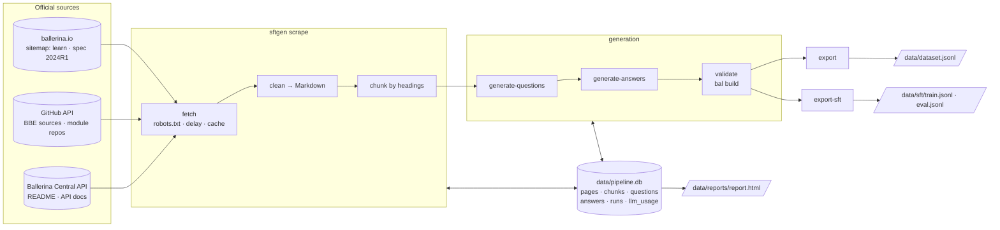
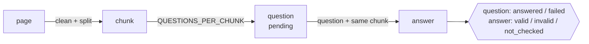

# Ballerina SFT Dataset Pipeline

[](LICENSE)


[](https://sajith-jeewantha.github.io/ballerina-sft-dataset-pipeline/architecture.html)

Builds a **grounded question-and-answer dataset** for fine-tuning a small language model on the
[Ballerina](https://ballerina.io) programming language.

It scrapes official Ballerina sources, splits them into heading-aware chunks, generates questions
from each chunk, and answers every question from **the same chunk**, citing its source URL. The
`bal` compiler can then check the code in the answers. Every step is tracked in one SQLite
database, and an HTML report shows progress after every command.

**🔗 Interactive architecture page:** https://sajith-jeewantha.github.io/ballerina-sft-dataset-pipeline/architecture.html
**📦 Repository:** https://github.com/sajith-jeewantha/ballerina-sft-dataset-pipeline

---

## Contents

- [How it works](#how-it-works)
- [Data sources](#data-sources)
- [Phases and commands](#phases-and-commands)
- [Limits and small test runs](#limits-and-small-test-runs)
- [The report](#the-report)
- [Output format](#output-format)
- [Storage](#storage)
- [Repository structure](#repository-structure)
- [Quick start: step by step](#quick-start-step-by-step)
- [Configuration](#configuration)
- [Re-running and resuming](#re-running-and-resuming)
- [Tests](#tests)
- [Documentation](#documentation)
- [License](#license)

---

## How it works





**Principles:** official sources only · answers are grounded in the chunk the question came from
and cite its URL · every record has a status and timestamps · small runs are cheap and
re-runs never repeat finished work.

Full design: [ARCHITECTURE.md](ARCHITECTURE.md) · [interactive page](https://sajith-jeewantha.github.io/ballerina-sft-dataset-pipeline/architecture.html)

---

## Data sources

Only these sources are used. The blog is **not** used.

| Source | What is collected | How |
|---|---|---|
| [Ballerina by Example](https://ballerina.io/learn/by-example/) (highest priority) | Each example's explanation, code and expected output, **exactly as written** | Page list from the ballerina.io sitemap; content from `ballerina-distribution/examples/<name>/` at the pinned tag, read from a sparse git snapshot (no API quota). The ballerina.io page only ships the explanation inside compiled JavaScript, so the source files are the faithful copy. |
| [Learn docs](https://ballerina.io/learn/) | Guides, tools, packages, tutorials, integration patterns | ballerina.io sitemap → each page's embedded Markdown source (exact text and code fences) |
| [Language spec 2024R1](https://ballerina.io/spec/lang/2024R1/) | The full spec, split by section headings, grammar kept as ```` ```ebnf ```` | One HTML page → structure-preserving Markdown |
| [Ballerina Central](https://central.ballerina.io/) | Package READMEs and API docs (function, client and type signatures) | Central's public JSON API: `/2.0/registry/packages` and `/2.0/docs/<org>/<pkg>/<version>`. No HTML scraping is needed. |
| [GitHub modules](https://github.com/orgs/ballerina-platform/repositories) | Module READMEs and `.bal` API source files from `module-ballerina-*` and `module-ballerinax-*` repos | GitHub REST API with `GITHUB_TOKEN`, most-starred repos first |

From the sitemap, only `/learn/`, `/learn/by-example/` and `/spec/lang/2024R1/` are kept. Old
version paths, robots-disallowed paths, index pages and duplicate URLs are skipped.

**Scraping rules:** one honest User-Agent, robots.txt respected for web pages,
`REQUEST_DELAY_SECONDS` between requests, raw pages cached in the database, unchanged content
skipped by blob SHA, package version, HTTP 304 or content hash, and failures logged per page
without stopping the run.

---

## Phases and commands

| Command | What it does | Status it sets |
|---|---|---|
| `sftgen scrape` | Fetch up to `LIMIT_SCRAPE_PAGES` new pages per source, convert them to clean Markdown and split them into heading-aware chunks | page: `chunked` · `empty` · `duplicate` · `blocked` · `failed` |
| `sftgen generate-questions` | For chunks with no questions yet, generate `QUESTIONS_PER_CHUNK` each, until `LIMIT_GENERATING` questions are saved. Each question is saved as soon as it is generated, with its chunk, source URL, category and difficulty. Near-duplicates are skipped. | question: `pending` |
| `sftgen generate-answers` | Answer every `pending` question using the question **and its saved chunk**. Answers include working Ballerina code when relevant, must not invent APIs, and cite the source URL. | question: `answered` · `failed` (with error) |
| `sftgen validate` *(optional)* | Compile the ```` ```ballerina ```` blocks in each answer with `bal` if it is installed | answer: `valid` · `invalid` · `not_checked` |
| `sftgen export` | Write `data/dataset.jsonl` for review (answers marked `invalid`, and questions overlapping the eval set, are left out) | — |
| `sftgen export-sft` | Write fine-tuning files in chat `messages` format: `data/sft/train.jsonl`, `eval.jsonl`, `metadata.jsonl` (eval-set overlaps left out) | — |
| `sftgen report` | Rebuild `data/reports/report.html` and print the summary | — |
| `sftgen run-all` | `scrape` → `generate-questions` → `generate-answers` → `validate` → `export` → `export-sft` | — |
| `sftgen graph validate` | Check `graph/graph.json`: schema 0.2 and the graph rules from [ballerina-ecosystem](https://github.com/sajith-jeewantha/ballerina-ecosystem), plus the hash recorded in `graph/SOURCE.json` | — |
| `sftgen graph stats` | Nodes, items and edges by type, priority, status and difficulty | — |
| `sftgen graph sync` | Load the graph into the database and match each item's sources to scraped pages (also runs after every `scrape`) | item: `grounded` · `not_scraped` · `external_only` · `retired` |
| `sftgen collect-repos` | Snapshot whole Ballerina repositories: the platform's module repos, `ballerina-guides`, wso2 and permissive external repos. Licence-gated, pinned, Swan Lake filter, dedup; up to `LIMIT_REPOS` clones per run. See [Code repositories](#code-repositories) | repo: `collected` · `excluded` · `licence_check` · `failed`; file: `kept` · `duplicate` · `near_duplicate` · `legacy` · `too_large` · `context` |
| `sftgen plan-prompts` | Show the prompt plan for the graph nodes in scope (`prompts.nodes`): items, budget, accepted and open slots per node. Also builds the FTS5 index and the Central symbol table. No model calls | — |
| `sftgen generate-prompts` | Fill open slots: the writer model (DeepSeek) writes prompts per graph item from its grounding; the judge model (another family) reviews them. Up to `LIMIT_GENERATING` prompts written per run. See [Item-driven prompts](#item-driven-prompts) | prompt: `accepted` · `rejected` · `duplicate` · `eval_overlap` |
| `sftgen answer-prompts` | Verified answers to accepted prompts: the teacher answers with the item's grounding; code is built with `bal`, prose is checked by the judge, and failures are repaired with the real errors (up to 3 attempts). Up to `LIMIT_GENERATING` prompts per run. See [Verified answers](#verified-answers) | response: `verified` · `judged` · `failed`; attempt: `pass` · `fail` |
| `sftgen codebases build` | Fill the codebase pool: 20 Swan Lake projects from the collected repos that build with the pinned `bal`, tagged with graph items, each turned into verified states (compile error, unfinished feature, version drift, failing test). See [Codebase pool](#codebase-pool) | codebase: `active` · `rejected`; state: `pass` · `fail` · `skipped` |
| `sftgen codebases verify` | Re-check every base and state with `bal`; exits with an error if anything is red | — |
| `sftgen codebases attach` | Turn verified states of train codebases into codebase-task prompts with the project packed in | prompt: `accepted` (`context_mode = codebase`) |
| `sftgen corpus` | Export the raw pretraining corpus: the kept copy of every Swan Lake `.bal` file from licence-safe repos, eval overlaps removed, generated code down-weighted; manifest, attribution, and per-repo totals in the licence register. See [Raw corpus and mined fixes](#raw-corpus-and-mined-fixes) | — |
| `sftgen mine-fixes` | Before/after bug fixes from the commit history of collected repos (blobless clones); up to `LIMIT_REPOS` repos per run | fix: `mined` |
| `sftgen eval fetch` | Fetch HumanEval (MIT, 164) and MBPP (CC BY 4.0, test split 11–510): pinned, licence-checked, recorded in the licence register | problem: `pending` |
| `sftgen eval translate` | The teacher translates each problem into a Ballerina task with a reference solution and `bal` tests; verified and repaired with the real errors. Up to `LIMIT_GENERATING` per run | problem: `translated` · `failed` |
| `sftgen eval tasks` | Eval tasks from the eval-split codebases (fix, implement, migrate, explain) and prompts for the BBE eval items | — |
| `sftgen eval ecosystem` | The teacher writes eval tasks per core graph node; a code reference must build | — |
| `sftgen eval run --model base` | Baseline a model (`base` = Qwen3.8-27B, or `teacher`): `eval.samples` answers per item, scored with `bal` and the judge, pass@k per suite and per graph item. See [Eval set v2 and baselines](#eval-set-v2-and-baselines) | run: `running` · `done` |
| `sftgen build-eval` | Build eval set v1 from Ballerina by Example: 30% of examples held out, tagged `node#item`, checked with `bal run`/`bal build`, and fingerprinted. Overlapping chunks, questions and repo files are flagged and left out of every export. See [Eval set and decontamination](#eval-set-and-decontamination) | eval item: `pass` · `output_differs` · `build_failed` · `run_failed` · `timeout` · `skipped`; chunk: `eval_holdout` |
| `sftgen storage status` | Compare the local data folder with the bucket: files not pushed, changed since the last push, or only in the bucket | — |
| `sftgen storage push` | Upload new or changed outputs and a database snapshot (commands already do this when `STORAGE_BUCKET=true`) | — |
| `sftgen storage pull` | Download what's missing locally: the newest database snapshot and the outputs. `--overwrite` replaces local files; the local database is backed up first | — |

Flags:
- `scrape --refresh`: re-check downloaded pages for changes.
- `scrape --update-lock`: re-resolve the pinned versions in `config/sources.lock.json`.
- `scrape --source bbe`: one source only (repeatable).
- `collect-repos --group guides`: one group only (repeatable). `--repo owner/name` adds one repo.
  `--refresh` re-clones. `--update-lock` re-pins to the latest default-branch commit.
- `build-eval --no-verify`: skip the `bal` checks. `--recheck` re-runs every check.
  `--update-lock` re-resolves the BBE tag.
- `answer-prompts --retry-failed`: give failed prompts another round of repairs.
- `generate-answers --retry-failed`
- `validate --recheck`
- `storage pull --overwrite`
- `--log-format text|json`

### Pinned sources

Everything is pinned to **one Swan Lake update**: `sources.swan_lake`, default `2201.14.1`.
The resolved pins are written to **`config/sources.lock.json`** the first time each source is
scraped, and reused on every later run:

| Source | Pinned to |
|---|---|
| Ballerina by Example | The `ballerina-distribution` release tag `v<swan_lake>`, resolved to a commit |
| Module repos | The commit seen on the first scrape |
| Ballerina Central | Per package, the newest version built for the pinned update or earlier (`ballerinaVersion` ≤ pin) |
| Spec | `2024R1` (the version is in the URL) |
| Learn pages | Not pinnable (live site); each page's content hash is kept in the database |

- **When a pin changes,** the page is downloaded again, even without `--refresh`.
- **To move to a new Swan Lake update,** change `sources.swan_lake`. A fresh lock starts, and
  the old one stays in git history.
- **The teacher's provider is pinned too.** Models whose id starts with `deepseek/` are sent
  to DeepSeek's own endpoint only (`generate.providers`), because DeepSeek's terms explicitly
  allow distillation. Each call records the provider that served it in `llm_usage.provider`.

Question categories: `concept`, `syntax`, `library`, `tooling`, `error-fixing`, `code-writing`,
`best-practice`. Difficulties: `beginner`, `intermediate`, `advanced`.

---

## Limits and small test runs

Set these in `.env`. Every command prints them at startup, so you can confirm what will run:

| Variable | Default | Meaning |
|---|---|---|
| `LIMIT_SCRAPE_PAGES` | `20` | Max pages to download **per source** per run. `0` = no limit. |
| `LIMIT_GENERATING` | `10` | Max questions to generate per run. `0` = no limit. |
| `QUESTIONS_PER_CHUNK` | `3` | Questions generated from each chunk |
| `REQUEST_DELAY_SECONDS` | `1` | Polite delay between requests |
| `LIMIT_REPOS` | `20` | `collect-repos`: max repositories cloned per run. `0` = no limit. Repos excluded by licence without cloning don't count. |
| `GITHUB_TOKEN` | — | GitHub API token: 5,000 requests/hour instead of 60 |

The answer phase answers every saved question that has no answer yet, so it is naturally limited
by `LIMIT_GENERATING`. With the defaults, one `run-all` downloads up to 100 pages (20 × 5
sources), generates 10 questions and answers them. Chunks are taken round-robin across sources,
so even 10 questions cover several sources. Each run continues where the last one stopped.

```
sftgen scrape
  database               data/pipeline.db
  LIMIT_SCRAPE_PAGES     20 pages per source per run
  LIMIT_GENERATING       10 questions per run
  QUESTIONS_PER_CHUNK    3
  REQUEST_DELAY_SECONDS  1
  GITHUB_TOKEN           set
  question model         qwen/qwen3.8-flash
  answer model           deepseek/deepseek-v4.1-flash
  Swan Lake pin          2201.14.1 (lock: config/sources.lock.json)
  storage                local only (STORAGE_BUCKET=false)
```

---

## The report

After every command a short summary is printed, and `data/reports/report.html` is rewritten. It's a
single file with no server needed:

```bash
open data/reports/report.html          # macOS
xdg-open data/reports/report.html      # Linux
start data\reports\report.html         # Windows
```

It shows:

- pages scraped: total, per source and per status, plus failed pages with their URLs and errors
- chunks created per source
- questions: total, and per source, category and difficulty
- answers: answered, pending and failed
- validation results
- run history: start time, duration, limits used and items processed
- token usage and cost per phase (OpenRouter returns the cost of each call)
- **knowledge-graph coverage:**
  - how many of the graph's 3,231 active items are grounded by a scraped page (or spec
    section), by priority and node type
  - which source pages to scrape next
  - the core items that are not grounded yet
- **code repositories:**
  - repos and unique `.bal` files per group
  - duplicates, legacy files and generated files
  - estimated tokens
  - licences of collected repos
  - the repos that need a manual licence check
- **eval set:**
  - eval items by category, and their `bal run`/`bal build` check results
  - chunks, questions and repo files held out because they overlap the eval set
  - rows each export dropped, and the overlap re-check of the written files (should be 0)
- 5 random Q&A samples, so you can spot-check quality

Terminal summary (illustrative numbers):

```
── Summary ─────────────────────────────────────────────────
Pages      9 total, 0 failed  |  usable: bbe 2, spec 1, learn 2, central 2, github 2
Chunks     1272  |  bbe 6, spec 351, learn 7, central 877, github 31
Questions  10  |  pending 0, answered 10, failed 0
Validation valid 6, not_checked 3, invalid 1
LLM usage  48,210 tokens, $0.0123
Report     data/reports/report.html
```

---

## Output format

### `data/dataset.jsonl` (review format, from `export`)

One object per line:

```json
{"question": "How do I access a nested field of a json value in Ballerina?",
 "answer": "Field access works directly on `json` because it is a lax type ...\n\n```ballerina\nimport ballerina/io;\n...\n```\n\nSource: https://ballerina.io/learn/by-example/access-json-elements/",
 "source_url": "https://ballerina.io/learn/by-example/access-json-elements/",
 "category": "code-writing",
 "difficulty": "beginner"}
```

### `data/sft/` (fine-tuning format, from `export-sft`)

`train.jsonl` and `eval.jsonl` hold chat `messages`. They load directly in **TRL**
`SFTTrainer`, **Axolotl** (`type: chat_template`) and **Unsloth**:

```json
{"id": "q42",
 "messages": [
   {"role": "system", "content": "You are an expert Ballerina (Swan Lake) programmer. Answer questions about ... say so instead of guessing."},
   {"role": "user", "content": "How do I access a nested field of a json value in Ballerina?"},
   {"role": "assistant", "content": "Field access works directly on `json` because it is a lax type ...\n\n```ballerina\n...\n```"}]}
```

- **Any base model:** the files hold no model-specific template. The trainer applies the model's
  chat template (`tokenizer.apply_chat_template`). A base model has no template of its own, so
  set one (for example ChatML or its instruct sibling's), use the same one at inference, and
  compute the loss on the assistant turn only.
- **Train/eval split:** by source page (`sft.eval_fraction`, default 5%), so no page feeds both
  sides.
- **Citations removed:** the trailing `Source: <url>` line is dropped by default
  (`sft.strip_source_line`), so the model doesn't learn to end answers with URLs it would invent.
- **Metadata:** `metadata.jsonl` keeps `id`, `split`, `source_url`, `category`, `difficulty`
  and `validation` for filtering and analysis.
- **System prompt:** set by `sft.system_prompt`; use `""` for none. It tells the model to answer
  accurately and concisely, write complete Ballerina that compiles with its imports, and say when it
  is unsure instead of inventing APIs. It's in every training row, so **use exactly the same text
  at inference**. If you change it, re-run `sftgen export-sft`; nothing else needs regenerating.

---

## Storage

A single SQLite file, `data/pipeline.db`. Every row has a `status`, `created_at` and `updated_at`.

| Table | One row per | Statuses |
|---|---|---|
| `pages` | source page or file: raw cache, clean Markdown, hashes, errors | `fetched` · `chunked` · `empty` · `duplicate` · `blocked` · `failed` |
| `chunks` | heading-aware piece of a page | `pending` · `questioned` · `too_small` · `failed` · `stale` |
| `questions` | generated question, with chunk, source URL, category, difficulty | `pending` · `answered` · `failed` |
| `answers` | answer to a question | `not_checked` · `valid` · `invalid` |
| `runs` | command run: limits, items processed, duration | `running` · `succeeded` · `failed` |
| `llm_usage` | model call: phase, tokens, cost, serving provider | `ok` · `error` |
| `graph_items` | knowledge-graph item (`node#item`), with priority, difficulty and coverage | `grounded` · `not_scraped` · `external_only` · `retired` |
| `item_sources` | an item's source URL matched to a scraped page (or spec section) | `matched` · `not_scraped` · `external` |
| `eval_items` | held-out eval item (BBE example): files, `covers`, check result | `active` · `retired` |
| `fingerprints` | exact hash, MinHash and shingles of each eval `.bal` file | — |
| `prompts` | prompt written for a graph item: task type, difficulty, `covers`, grounding, review | `accepted` · `rejected` · `duplicate` · `eval_overlap` |
| `symbols` | Central API entry (signatures, fields) by `module:Name`, parsed from Central pages | — |
| `chunks_fts` | FTS5 (BM25) full-text index over chunks, for grounding | — |
| `attempts` | every teacher answer to a prompt (first try and repairs) with its checks and feedback | `pass` · `fail` |
| `responses` | outcome per prompt: final attempt, attempts used, repaired, verification | `verified` · `judged` · `failed` |
| `preference_pairs` | the first failed answer and the passing repair of a prompt (for DPO) | — |
| `codebases` | a project in the pool: files, graph tags, train/eval split | `active` · `rejected` |
| `codebase_states` | a broken or unfinished version of a codebase: changed files, patch, verification | `pass` · `fail` · `skipped` |
| `mined_fixes` | a before/after fix from a repo's history: files, diff, whether tests changed | `mined` |
| `benchmark_problems` | a HumanEval / MBPP problem fetched for translation | `pending` · `translated` · `failed` |
| `eval_runs` | one baseline run: model, mode (`compile` / `test`), samples | `running` · `done` |
| `eval_results` | one sampled answer to an eval item and whether it passed | — |

Inspect it with any SQLite tool, e.g. `sqlite3 data/pipeline.db "SELECT status, COUNT(*) FROM questions GROUP BY 1"`.
Column reference: [docs/schemas.md](docs/schemas.md).

### Code repositories

`sftgen collect-repos` adds whole repositories, for the raw code corpus and the codebase pool
in later milestones. Groups are set in `repos.groups` in `pipeline.yaml`; earlier groups win
when files are duplicated:

| Group | Repos |
|---|---|
| `platform` | `ballerina-platform/module-ballerina-*` and `module-ballerinax-*` |
| `guides` | every `ballerina-guides` repo |
| `wso2` | `wso2` repos whose main language is Ballerina |
| `external` | other Ballerina repos pushed since Swan Lake GA (2022-02), most-starred first, not forks or archived |

For each repo:

1. **Licence pre-gate.** If GitHub reports no licence or a copyleft licence, the repo is
   excluded without downloading anything.
2. **Pin.** The default branch is pinned to a commit with `git ls-remote` (no API quota) in
   `config/sources.lock.json`.
3. **Snapshot.** A blobless, shallow, sparse clone downloads only `*.bal`, `Ballerina.toml`,
   `*.out`, READMEs and the root LICENSE.
4. **Licence gate on the LICENSE text.**
   - `safe` (a permissive licence that agrees with GitHub): the files are kept.
   - `check` (no file, unrecognised text, or a mismatch): the repo waits for a person.
   - `exclude` (copyleft, or no licence at all).
5. **Classify each `.bal` file** as `swan_lake`, `legacy` (1.x) or `unknown`, using the
   project's `distribution`, the `Ballerina.toml` layout and syntax markers. Generated files are
   flagged so later steps can down-weight them.
6. **Dedup** across all repos: an exact match on code without comments or whitespace, then
   MinHash near-duplicates (similarity ≥ 0.8).

Files are stored in `repo_files`, and a `.tar.gz` snapshot of each repo goes to
`data/repos/`.

**The licence register** is `docs/licence-register.csv`. It has one row per repo reviewed:
licence, verdict, pinned commit, sha256 of the LICENSE file and file count. Unlicensed search
results stay in the database only. People can edit it:
- **Block a repo:** set its row to `exclude`.
- **Allow a `check` repo after reading its licence:** set the row to `safe` and start `notes`
  with `verified:`.

### Eval set and decontamination

`sftgen build-eval` builds the held-out evaluation set and keeps it out of training:

1. **Pin** `ballerina-distribution` at the tag of the pinned Swan Lake update (`v2201.14.1`),
   recorded under `bbe` in `config/sources.lock.json`, and fetch `examples/` with a sparse clone.
2. **Split** the examples listed in `examples/index.json` 30% eval / 70% train **by example**:
   a hash of the example name decides, so an example never changes side when others are added.
3. **Tag** each eval item with the graph items (`node#item`) whose own sources are that example.
4. **Check** each eval item with the pinned toolchain. `run`: one `.bal` file with a
   `$ bal run` transcript, whose output must match the `.out` file line by line. `build`:
   every other example that upstream CI builds. `none`: not checked upstream.
5. **Fingerprint** each eval `.bal` file: an exact hash (comments and layout ignored), MinHash,
   and its distinctive 5-token shingles (those not found in 10 or more BBE examples).
6. **Decontaminate.** A chunk, question+answer or repo `.bal` file overlaps an eval item when it
   has the same code, a MinHash similarity ≥ 0.8, or contains ≥ 50% of the item's distinctive
   shingles. Overlaps are recorded in `eval_overlap`. Eval pages and overlapping chunks become
   `eval_holdout`, so no questions are generated from them, and every export leaves overlapping
   questions out, then re-checks what it wrote (`eval_overlap_in_export`, which should be 0).
   This runs again after `scrape`, `collect-repos`, and before `generate-questions` and the exports.

Outputs, in `data/eval/v1/`:

| File | Contents |
|---|---|
| `bbe.jsonl` | one eval item per line: `id`, `title`, `category`, `url`, `commit`, `covers` (`node#item`), `nodes`, `explanation` (`.md`), `code` (`.bal` files), `outputs` (`.out` transcripts), `other_files`, `verify` |
| `decontam.jsonl` | the fingerprints: item, file, `code_hash`, MinHash and shingles (hex) |
| `split.json` | both sides of the split, the rule, the commit and the fingerprint settings |

`export-sft`'s `eval.jsonl` is still a validation split of the Q&A rows (by source page) for
training; the benchmark eval set is `data/eval/`. Thresholds are in `eval:` in `pipeline.yaml`.

### Item-driven prompts

`sftgen generate-prompts` writes the training prompts **per knowledge-graph item**, rather than
per scraped chunk, so coverage follows the graph.

1. **Plan** (`sftgen plan-prompts`, no model calls). Scope is `prompts.nodes`; the pilot is the
   HTTP cluster (`lib.http`, `topic.rest_api`, services and listeners, resource methods, client
   objects, auth, jwt, oauth2, mime: 122 items, 884 prompts). Each item gets a budget by its
   node's priority (core 10, important 6, long tail 3), split over the task mix (`write_code`,
   `use_api`, `explain`, `fix_code`, `design`) and the item's own difficulties.
2. **Ground** each item, up to ~3,500 tokens:
   - **Own sources:** the item's own source pages (best-matching chunks; for the spec, only the
     named section). GitHub files are read from the repos `collect-repos` snapshotted.
   - **Central symbols:** exact signatures and fields for the names the item mentions.
   - **Node sources:** the node's sources, for items without their own.
   - **FTS5 neighbours:** the best BM25 matches anywhere in the corpus.

   Nothing that overlaps the eval set is used.
3. **Write:** one call per item to the writer, `PROMPT_WRITER_MODEL` (default
   `ANSWER_GEN_MODEL`, the DeepSeek teacher), with the item, its grounding and the open slots.
4. **Filter:**
   - prompts that refer to "the excerpts";
   - near-duplicates of prompts already in the set;
   - prompts that overlap the eval set.
5. **Review:** one call per item to the judge, `JUDGE_MODEL` (default `QUESTION_GEN_MODEL`). It
   must be a different model family from the writer. It scores each prompt 1–5 for on-item,
   answerable, clear, realistic and task fit, and a prompt is accepted only if every score is
   at least 3.
6. **Gap-fill:** rejected slots stay open. The next run writes them again and shows the writer
   the prompts already accepted, up to 3 writer calls per item.

Outputs, in `data/prompts/<set>/`: `accepted.jsonl` (with `covers`, task type, difficulty,
grounding URLs and review scores), `rejected.jsonl` and `coverage.json` (planned and accepted
per item). The report shows the plan per node, the task × difficulty mix, review scores,
rejection reasons and 100 accepted prompts to read. Answers for these prompts come in M6.

### Verified answers

`sftgen answer-prompts` answers every accepted prompt with the teacher (`ANSWER_GEN_MODEL`) and
keeps only answers that pass their checks.

**Answer format** (the contract the teacher is given, and what the checks enforce):
- Answer directly, with no mention of reference material and no URLs or `Source:` lines.
- Code goes in ```` ```ballerina ```` blocks, and **every block must compile** with Swan Lake 2201.14.1.
- A solution with several files gives **each file in full** in its own block, starting with
  `// file: <path>` (for example `// file: main.bal`, `// file: tests/main_test.bal`). Those
  blocks are built together as one package. Codebase tasks (M7) will use the same format: every
  changed file in full, under its path.
- For a fix, show the corrected code in full, not the broken version.

**Checks, then repair:**
1. **Format:** answers that mention excerpts or reference material, or end with a `Source:`
   line, fail.
2. **Code:** blocks are built with `bal` (`// file:` blocks as one package). Test files are
   type-checked without running anything (they are built as ordinary sources with `bal build`), and
   **run only if `answers.run_tests: true`**,
   because running them executes model-written code; use a sandbox for that. `write_code` and
   `fix_code` answers must contain code.
3. **Judge:** `explain` and `design` answers, and any answer without code, are checked by the
   judge (`JUDGE_MODEL`, a different family from the teacher) for correctness against the
   grounding, completeness and clarity.
4. **Repair:** a failed answer goes back to the teacher with the real problems: compiler errors
   with file and line, failing tests, or the judge's issues. There are up to 3 attempts in all.
   `--retry-failed` gives failed prompts another round.

**Records:**
- every attempt (`attempts`);
- the outcome per prompt (`responses`): `verified` = code checked by the toolchain, `judged` =
  prose checked by the judge, `failed`;
- a **preference pair** when a repair passes: the first failed answer as *rejected*, the
  passing one as *chosen*.

Outputs, in `data/answers/<set>/`:

| File | Contents |
|---|---|
| `sft.jsonl` | verified and judged answers as chat `messages` (system prompt from `sft.system_prompt`, user prompt, assistant answer), with `covers`, task type, difficulty, verification, attempts |
| `pairs.jsonl` | DPO pairs in TRL's conversational format: `prompt`, `chosen`, `rejected` (message lists), with the reason the rejected answer failed |
| `failed.jsonl` | prompts that failed every attempt, with the last answer and its checks |

The report's *Answers* section shows the pass rate, first-try rate, repair rate, attempts used,
why attempts failed, the most common compiler errors, and results by task type. Cost per phase
(`answer-prompts`, `repair-answers`, `judge-answers`) is in the usage table.

### Codebase pool

`sftgen codebases build` builds the pool of real projects that codebase tasks start from.

1. **Candidates:** every `Ballerina.toml` project (`[package]` layout) in a collected,
   licence-safe repo. It must have no 1.x syntax, no generated code and nothing copied from the
   eval set, 2–40 `.bal` files, and roughly 0.8k–10k tokens, so it fits a prompt.
2. **Rank:** ballerina-guides first, then wso2, external and platform repos; projects with tests
   preferred; at most 3 per repo.
3. **Verify the base:** the project must build with `bal` 2201.14.1. Its tests are type-checked
   without running anything. Candidates are tried in rank order until 20 build.
4. **Tag** it with graph nodes (from its imports) and items (qualified names such as
   `http:NotFound` that appear in the code).
5. **Split:** 20% of the pool (by a hash of its id) is held out for M8's eval tasks and never
   feeds training prompts.
6. **States:** each is a deterministic edit, verified with `bal`:

| State | Edit | Verified when | Prompt |
|---|---|---|---|
| `compile_error` | one call to a project function is misspelled (or a used import removed) | the build fails, in that file | fix_code: the real `bal build` errors are quoted |
| `unfinished_feature` | one function's body becomes a stub that panics "not implemented" | it still builds | write_code: implement it |
| `version_drift` | an HTTP service is rewritten in Ballerina 1.x style (`@http:ServiceConfig {basePath}`, `@http:ResourceConfig`) | the build fails | fix_code: migrate to Swan Lake |
| `failing_test` | one operator in tested code is flipped | its tests fail; this **runs** the project's tests, so only with `codebases.run_tests` (otherwise `skipped`) | fix_code: the failing test is quoted |

`sftgen codebases verify` re-checks every base and state and fails if anything is red.
`sftgen codebases attach` turns each verified state of a train codebase into a prompt
(`context_mode = codebase`). The project is packed in under `// file:` headers, up to ~14k
tokens: Ballerina.toml, the file the task is about, then the other files, smallest first, then
the tests. `answer-prompts` answers these too. The answer's changed files are laid over the
state, the project must build, and a stubbed function must actually be implemented.

Files in `data/codebases/`: `<id>/base.tar.gz`, `<id>/states/<kind>.patch` and `manifest.jsonl`
(source, licence, split, tags and states per codebase).

### Raw corpus and mined fixes

**`sftgen corpus`** writes the raw code corpus for continued pretraining to `data/corpus/raw-v1/`.

- **What goes in:** each `.bal` file that is the kept copy after dedup, in a collected,
  licence-safe repo. It must be Swan Lake or unclassified (never 1.x syntax), not overlapping the
  eval set (decontamination runs first), not part of an eval-split codebase, and at least 20
  tokens.
- **Weights:** generated code (OpenAPI connectors, "do not edit" files) stays in with
  `weight: 0.3`, so a trainer can sample it less; everything else has weight 1.

| File | Contents |
|---|---|
| `part-NNNN.jsonl.gz` | one record per file: `id`, `text`, `repo`, `path`, `commit`, `url`, `licence`, `group`, `syntax`, `generated`, `weight`, `tokens` (~5M tokens per part) |
| `manifest.json` | totals: files, tokens, weighted tokens, by source group, licence and syntax, and what was left out and why |
| `ATTRIBUTION.md` | every repository in the corpus with its licence, pinned commit, files and tokens |

The licence register gets `corpus_files` and `corpus_tokens` per repo.

**`sftgen mine-fixes`** mines real bug fixes from the history of collected repos (guides,
platform and wso2 by default), up to `LIMIT_REPOS` repos per run:

1. **Clone:** a blobless bare clone with full history. Only commits and trees are downloaded;
   file contents are fetched for qualifying commits only.
2. **Scan:** the latest 400 non-merge commits touching `.bal` files. A commit qualifies when:
   - its message reads like a fix and not like a bump, release, merge, revert, dependency
     update, regeneration, formatting or review change;
   - its author isn't a bot;
   - it modifies 1–3 existing `.bal` source files (tests may change too), with at most 80 lines
     changed and at least one deleted (pure additions are features).
3. **Keep:** pairs with 1.x syntax, or overlapping the eval set, are dropped, and duplicates are
   merged.

The fixes go to `mined_fixes` and `data/corpus/raw-v1/fixes.jsonl` (files before and after, diff,
whether tests changed). They are **not built** at their commit; M10 checks them before using them
as fix tasks. The register gets `mined_fixes` per repo.

### Eval set v2 and baselines

`sftgen eval` grows the eval set and measures models on it, so you can later tell whether the
dataset helped.

| Suite | Items | Scored by |
|---|---|---|
| `humaneval` | 164, translated from HumanEval (MIT) | the answer's function built with the item's `bal` tests (tests run with `eval.run_tests`) |
| `mbpp` | 500, MBPP's official test split (CC BY 4.0, attributed in the dataset card) | the same |
| `bbe` | the 188 held-out BBE examples (M4): write the program the explanation describes | output compared with `.out` (`eval.run_tests`), otherwise it must compile |
| `codebase` | the eval-split codebases (M7): fix, implement, migrate, plus an explain task each | the changed files laid over the state must build; explain by the judge |
| `ecosystem` | tasks the teacher writes per core graph node | code must compile; explain by the judge |

- **Translation:** `eval translate` gives the teacher the Python problem, solution and tests. It
  returns a Ballerina prompt (with the function signature), a reference solution and a test file.
  These must build together (tests run with `eval.run_tests`); failures are repaired with the real
  errors, up to 3 attempts.
- **Decontamination:** every eval item's code is fingerprinted, so decontamination keeps
  near-copies out of training.
- **Baselines:** `eval run --model base` (Qwen3.8-27B) and `--model teacher` sample `eval.samples`
  answers per item. They use the training system prompt, so the base model sees what the
  fine-tuned one will.
- **pass@k:** the unbiased estimator per item, averaged per suite and per graph item (`covers`).
  The report shows a **per-item score map**: pass@1 per graph item for each run.
- **Executing code:** scoring benchmark tests and BBE output **runs model-written code**, so it
  needs `eval.run_tests: true` (use a container or VM). Without it, runs are labelled mode
  `compile` and score compilation only. Don't compare runs of different modes.
- **Resuming:** runs resume where they stopped (results are saved per sample);
  `LIMIT_GENERATING` caps the samples per invocation.

### Local folder and cloud bucket

Everything the pipeline writes lives under **`LOCAL_DATA_DIR`** (default `data/`). That folder is
always the working copy, because SQLite and `bal build` need a real disk. Set
`STORAGE_BUCKET=true` to keep a copy in a GCS or S3 bucket **with the same layout**:

| Local (`data/…`) | Bucket (`gs://BUCKET/PREFIX/…`) |
|---|---|
| `dataset.jsonl`, `sft/*.jsonl`, `reports/report.html` | same paths |
| `pipeline.db` | `db/pipeline-<UTC time>.db.gz` snapshots; `db/LATEST` names the newest |
| `config/sources.lock.json` (repo) | `sources/sources.lock.json` |
| `graph/graph.json`, `graph/SOURCE.json` (repo) | `graph/<graph commit>/graph.json`, `SOURCE.json` |
| `cache/` (HTTP, model and compiler caches) | never uploaded |

With the bucket on, every command:
1. **Restores** the database from `db/LATEST` if there's no local `pipeline.db` (for example on a
   new machine or cloud VM).
2. **Uploads** each phase's new or changed files as soon as the phase succeeds. Unchanged files
   are skipped.
3. **Uploads a database snapshot** at the end. The 20 newest are kept (`storage.keep_db_snapshots`).

If an upload fails, the command still saves everything locally and exits with code 1; run
`sftgen storage push` to retry. Only one machine should write to a bucket prefix at a time.

**Set it up** in `.env`:

```env
STORAGE_BUCKET=true
STORAGE_PROVIDER=gcs        # or aws-s3
BUCKET_NAME=ballerina-slm-data
BUCKET_PREFIX=              # optional sub-folder
```

- **GCS:** run `pip install -e "shared[gcs]"` and `gcloud auth application-default login`.
- **AWS S3:** run `pip install -e "shared[s3]"` and set `AWS_PROFILE` (from `~/.aws/credentials`)
  and `AWS_REGION`.
- **S3-compatible stores** such as Cloudflare R2: use `aws-s3` and also set `S3_ENDPOINT_URL`.
- No keys go in `.env`.
- To try the layout without a cloud account, set `STORAGE_PROVIDER=local` and
  `BUCKET_NAME=/some/folder`.

---

## Repository structure

```
ballerina-sft-dataset-pipeline/
├── README.md · ARCHITECTURE.md · architecture.html · CHANGELOG.md · LICENSE
├── .env.example                  # secrets, models and run limits template
├── config/pipeline.yaml          # all non-secret settings
├── docs/
│   ├── recommendations.md        # design research (v2; partly superseded, see note inside)
│   └── schemas.md                # SQLite tables and columns
├── shared/balpipe_common/        # config · db (SQLite) · graph · lock · storage · licences · dedup · decontam · ids · logging
├── scraper/ballerinascraper/
│   └── ballerinascraper/
│       ├── scrape.py             # fetch loop: limits, caching, change detection, failures
│       ├── repos.py              # collect-repos: licence gate, sparse snapshots, Swan Lake filter, dedup
│       └── collectors/           # ballerina_io (sitemap) · github · central · http · robots
├── sft-dataset-generator/
│   ├── src/sftgen/
│   │   ├── cli.py                # the commands
│   │   ├── clean/                # extractors (page → Markdown) · question dedup
│   │   ├── chunk/                # heading-aware chunker
│   │   ├── generate/             # questions · answers · prompts (writer/reviewer) · responses (answer, check, repair) · LLM client
│   │   ├── validate/             # bal compiler wrapper (files, packages, tests) · answer checks
│   │   ├── export/               # dataset.jsonl · sft (chat messages)
│   │   ├── plan/                 # planner: item budgets, slots, gaps
│   │   ├── codebases/            # pool (select, verify, tag) · states · attach (context packing) · stage
│   │   ├── eval/                 # bbe (v1) · verify · benchmarks (fetch, translate) · tasks · runner (pass@k)
│   │   ├── corpus/               # raw (corpus export, attribution) · miner (before/after fixes)
│   │   ├── retrieval/            # FTS5 search · Central symbol table · grounding per item
│   │   ├── report.py
│   │   └── prompts/              # questions.yaml · answer.yaml
│   └── tests/
└── data/                         # gitignored (LOCAL_DATA_DIR): pipeline.db · dataset.jsonl · sft/ ·
                                  #   reports/report.html · cache/ · .storage/ (push bookkeeping)
```

---

## Quick start: step by step

Everything from an empty machine to a fine-tuning dataset. Run the commands from the repo root.

### 0. Requirements

- **Python 3.11+**
- **An [OpenRouter](https://openrouter.ai) API key**, or any OpenAI-compatible endpoint
- **A GitHub token** (recommended): a fine-grained token with read-only access to public
  repositories is enough
- **Optional:** the [Ballerina CLI](https://ballerina.io/downloads/) (`bal`, tested with
  2201.14.x), needed only for `validate`

### 1. Get the code

```bash
git clone https://github.com/sajith-jeewantha/ballerina-sft-dataset-pipeline.git
cd ballerina-sft-dataset-pipeline
```

Already cloned? Update it instead:

```bash
git pull
```

### 2. Create a virtual environment and install

```bash
python3.11 -m venv .venv
source .venv/bin/activate          # Windows: .venv\Scripts\activate
pip install -e shared -r scraper/requirements.txt -e scraper \
            -r sft-dataset-generator/requirements.txt -e sft-dataset-generator -r requirements-dev.txt
```

> If you renamed or moved the project folder, delete `.venv` and run this step again: the
> virtual environment stores absolute paths.

### 3. Configure `.env`

```bash
cp .env.example .env
```

Open `.env`, fill these in and **save the file**:

```env
OPENROUTER_API_KEY=sk-or-...
QUESTION_GEN_MODEL=qwen/qwen3.8-flash
ANSWER_GEN_MODEL=deepseek/deepseek-v4.1-flash
GITHUB_TOKEN=github_pat_...

LIMIT_GENERATING=10        # small first run
LIMIT_SCRAPE_PAGES=20
QUESTIONS_PER_CHUNK=3
REQUEST_DELAY_SECONDS=1
```

### 4. Check the setup

```bash
sftgen report       # prints the limits, models and whether GITHUB_TOKEN is set; creates data/pipeline.db
bal version         # optional, for validate
pytest shared/tests scraper/ballerinascraper/tests sft-dataset-generator/tests
```

The startup block must show your models and `GITHUB_TOKEN set`. If it says `not set`, the `.env`
file wasn't saved or the value is empty.

### 5. Run everything with one command

```bash
sftgen run-all
```

This runs `scrape` → `generate-questions` → `generate-answers` → `validate` → `export` →
`export-sft`, then prints the summary and writes the report. With the limits above it downloads
up to 100 pages and generates and answers 10 questions, for a few cents of model calls.

### 6. Or run each phase yourself

Use this when you want to check each step before the next one:

```bash
sftgen scrape                # 1. fetch pages → clean Markdown → chunks
sftgen generate-questions    # 2. up to LIMIT_GENERATING new questions
sftgen generate-answers      # 3. answer every pending question from its chunk
sftgen validate              # 4. optional: compile the Ballerina code in answers
sftgen export                # 5. data/dataset.jsonl (review format)
sftgen export-sft            # 6. data/sft/train.jsonl, eval.jsonl, metadata.jsonl (fine-tuning)
```

Each command prints its limits first and a summary at the end, and refreshes the report.

### 7. Check the results

```bash
open data/reports/report.html        # macOS; Linux: xdg-open; Windows: start
head -n 3 data/dataset.jsonl
head -n 1 data/sft/train.jsonl
sqlite3 data/pipeline.db "SELECT status, COUNT(*) FROM questions GROUP BY 1"
```

In the report, read the **Sample Q&A** section and check the **Failed pages** table before you
scale up.

### 8. Scale up

When the samples look good, raise the limits in `.env` (for example `LIMIT_GENERATING=200`, or
`0` for no limit) and run again:

```bash
sftgen run-all
```

Every run continues where the last one stopped. Pages already downloaded aren't fetched again,
chunks that already have questions are skipped, and only `pending` questions are answered.

### 9. Fine-tune

Point your trainer at `data/sft/train.jsonl` and `data/sft/eval.jsonl`: TRL `SFTTrainer`,
Axolotl (`type: chat_template`) or Unsloth. See [Output format](#output-format).

### Useful extra commands

| Command | When |
|---|---|
| `sftgen scrape --source bbe` | Scrape one source only (`bbe`, `spec`, `learn`, `central`, `github`; repeatable) |
| `sftgen scrape --refresh` | Re-check pages you already have for upstream changes |
| `sftgen scrape --update-lock` | Re-resolve the pinned commits and Central versions in `config/sources.lock.json` |
| `sftgen graph validate` | Check the knowledge graph before using it |
| `sftgen collect-repos --group guides` | Collect one repo group; `LIMIT_REPOS=0` for all of it |
| `sftgen collect-repos --repo owner/name` | Collect one repository |
| `sftgen plan-prompts` | See budgets, accepted and open prompt slots per node before spending anything |
| `LIMIT_GENERATING=30 sftgen generate-prompts` | A small prompt batch (about 3 items) to check quality and cost |
| `LIMIT_GENERATING=20 sftgen answer-prompts` | Answer 20 accepted prompts, to check pass and repair rates and cost |
| `sftgen codebases verify` | Check that every codebase base and state still verifies (e.g. after a `bal` update) |
| `LIMIT_REPOS=60 sftgen mine-fixes` | Mine fixes from the next 60 repos (repos already mined are skipped) |
| `LIMIT_GENERATING=20 sftgen eval translate` | Translate 20 benchmark problems to check quality and cost |
| `sftgen eval run --model teacher --suite humaneval` | Baseline one model on one suite |
| `sftgen answer-prompts --retry-failed` | Give prompts that failed every attempt another round of repairs |
| `sftgen build-eval` | Rebuild the eval set and re-flag overlaps (after a new Swan Lake pin) |
| `sftgen build-eval --recheck` | Re-run every `bal run`/`bal build` check, e.g. after installing a new `bal` |
| `sftgen storage status` | See what's local only, changed, or only in the bucket |
| `sftgen storage pull` | On a new machine: get the database and outputs from the bucket |
| `sftgen generate-answers --retry-failed` | Retry questions whose answer call failed |
| `sftgen validate --recheck` | Re-compile all answers, e.g. after installing a new `bal` |
| `sftgen report` | Rebuild the report and summary at any time |
| `sftgen <command> --log-format json` | Machine-readable logs |
| `LIMIT_GENERATING=5 sftgen generate-questions` | Override a limit for one command |
| `rm -rf data` | Start over from scratch. This deletes the database, so any generated questions and answers are lost. The model response cache in `data/cache/llm` is deleted too. |

---

## Configuration

| Where | What | Committed? |
|---|---|---|
| `.env` (copy `.env.example`) | `OPENROUTER_API_KEY`, `LLM_BASE_URL`, `QUESTION_GEN_MODEL`, `ANSWER_GEN_MODEL`, `PROMPT_WRITER_MODEL`, `JUDGE_MODEL`, `GITHUB_TOKEN`, the run limits above, and the storage switch (`STORAGE_BUCKET`, `STORAGE_PROVIDER`, `BUCKET_NAME`, `BUCKET_PREFIX`, `LOCAL_DATA_DIR`, `AWS_*`, `S3_ENDPOINT_URL`) | ❌ never |
| `config/pipeline.yaml` | source filters, crawl politeness, chunk size, concurrency, temperatures, compiler settings, export, SFT export (eval share, system prompt, citation stripping), report, and bucket snapshot settings. Output paths are relative to `LOCAL_DATA_DIR` | ✅ |

- Precedence: **environment > `.env` > `pipeline.yaml` > defaults**. Empty values in `.env` are
  ignored. Override any YAML key with `BALPIPE__SECTION__KEY`, e.g. `BALPIPE__GENERATE__CONCURRENCY=2`.
- Secrets are never logged or stored in the database.
- To keep a laptop cool during `validate`, lower `validate.workers` (default 2).

---

## Re-running and resuming

Just run the command again. Every write is committed immediately, and each phase picks up from
the statuses:

- `scrape` skips pages it already has (`--refresh` re-checks them). The sitemap, repo lists and
  trees are cached for 24 hours. Failed pages are retried.
- `generate-questions` only takes chunks with no questions. A chunk whose call fails is retried
  up to 3 times.
- `generate-answers` only takes `pending` questions (`--retry-failed` adds the failed ones).
- Model responses and compile results are cached in `data/cache/`, so repeated work costs nothing.

---

## Tests

```bash
pytest shared/tests scraper/ballerinascraper/tests sft-dataset-generator/tests
```

The tests cover:

- config and limits
- the SQLite store and run tracking
- robots.txt and sitemap filtering
- the fetch loop: caching, change detection, failures and per-source limits
- every extractor: BBE code kept verbatim, embedded Markdown, the spec, Central API docs
- chunking (code blocks never split, budgets)
- question limits, round-robin, filters and dedup
- answers with citations and failure recording
- export filtering, the SFT `messages` export (split by page, citation removed) and the HTML report
- a real `bal` compile round trip when Ballerina is installed

---

## Documentation

| Document | Contents |
|---|---|
| [Architecture page](https://sajith-jeewantha.github.io/ballerina-sft-dataset-pipeline/architecture.html) | Interactive diagrams and phase explorer |
| [ARCHITECTURE.md](ARCHITECTURE.md) | Components, data flow, storage, reliability |
| [docs/schemas.md](docs/schemas.md) | SQLite tables, columns and statuses |
| [docs/recommendations.md](docs/recommendations.md) | Research behind the v2 design choices |
| [CHANGELOG.md](CHANGELOG.md) | What changed and why |
| [scraper/README.md](scraper/README.md) · [sft-dataset-generator/README.md](sft-dataset-generator/README.md) | Per-project details |

---

## License

The code is licensed under the [Apache License 2.0](LICENSE).

Datasets you generate with it are a separate matter. Their licensing depends on the upstream
sources (the license of each GitHub repo and Central package is stored per page) and on the
terms of the LLMs you use to generate them.
