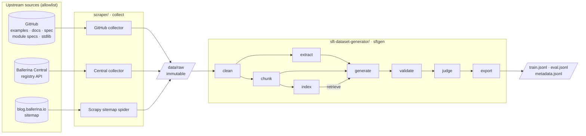
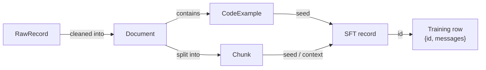

# Ballerina SFT Dataset Pipeline

[](LICENSE)


[](https://sajith-jeewantha.github.io/ballerina-sft-dataset-pipeline/architecture.html)

Builds a **traceable, compiler-verified supervised fine-tuning (SFT) dataset** for a small
language model specialised in the [Ballerina](https://ballerina.io) programming language.

It collects official Ballerina sources, cleans them into Markdown, pairs every code example with
the prose that explains it, and generates chat-format training data. That data is filtered by the
real `bal` compiler and a rubric-based LLM judge. Every training record can be traced back to the
exact upstream file and commit it came from.

**🔗 Interactive architecture page:** https://sajith-jeewantha.github.io/ballerina-sft-dataset-pipeline/architecture.html
**📦 Repository:** https://github.com/sajith-jeewantha/ballerina-sft-dataset-pipeline

---

## Contents

- [Why this pipeline](#why-this-pipeline)
- [Architecture](#architecture)
- [Data sources](#data-sources)
- [Pipeline stages](#pipeline-stages)
- [Training tasks](#training-tasks)
- [Output format](#output-format)
- [Repository structure](#repository-structure)
- [Quick start](#quick-start)
- [Configuration](#configuration)
- [Resuming after a failure](#resuming-after-a-failure)
- [Quality and safety](#quality-and-safety)
- [Tests](#tests)
- [Documentation](#documentation)
- [License](#license)

---

## Why this pipeline

| Problem with naïve scraping + RAG generation | What this pipeline does instead |
|---|---|
| Raw HTML full of scripts and navigation; by-example code isn't even in the page HTML | Reads the **upstream source files** (GitHub repos, Central API). It only crawls HTML where no source exists. |
| Code flattened or split mid-block during chunking | Chunks along headings and never splits a code block |
| Generated code that doesn't compile, or uses invented APIs | Every code block is compiled with `bal`, and unknown `module:symbol`s are flagged |
| Answers that say "based on the provided context…" | Prompts forbid it and a regex filter rejects leaks |
| No way to tell where a training example came from | Each record keeps seed → chunk → document → commit SHA/URL, plus the models, prompt versions and scores |
| Train/eval contamination | Split per source document, retrieval limited to the same split, 13-gram decontamination |
| A crash loses hours of LLM calls | Per-item checkpoints, run manifests and an on-disk LLM cache: just re-run |

---

## Architecture





**Principles:** source first · raw data is never modified · one stage, one output, one manifest ·
idempotent and resumable · verify instead of trusting · traceable end to end.

Full design: [ARCHITECTURE.md](ARCHITECTURE.md) · [interactive page](https://sajith-jeewantha.github.io/ballerina-sft-dataset-pipeline/architecture.html)

---

## Data sources

| Source | What is collected | How |
|---|---|---|
| [Ballerina by Example](https://ballerina.io/learn/by-example/) | ~600 examples: `.bal` code + `.md` explanation + `.out` expected output | GitHub `ballerina-distribution/examples`, pinned to a commit |
| [Learn docs](https://ballerina.io/learn/) | Guides and tutorials | Markdown sources in `ballerina-dev-website` |
| [Language spec 2024R1](https://ballerina.io/spec/lang/2024R1/) | The full specification, with grammar kept as ```` ```ebnf ```` | Structure-preserving HTML → Markdown |
| Stdlib module specs (`/spec/http`, `/spec/sql`, …) | ~48 module specifications | `public/spec/*/spec.md` |
| [Enterprise integration patterns](https://ballerina.io/learn/enterprise-integration-patterns/) | Integration code + pattern descriptions | `.bal` + `.yml` bundles |
| [Ballerina Central](https://central.ballerina.io/) | Package READMEs, licenses, versions | Registry API (`ballerina`, `ballerinax` orgs) |
| Stdlib modules (`http`, `io`; add more in config) | Public API source + doc comments | Module repos |
| [Blog](https://blog.ballerina.io/) | Technical posts with code | Sitemap crawl (no source repo exists) |

Excluded on purpose: marketing, events, release-note announcements, and Stack Overflow (its
robots.txt disallows all bots). Crawling uses one honest User-Agent, obeys robots.txt and rate
limits, and uses no proxies.

---

## Pipeline stages

| Stage | Command | Reads → writes | What it does |
|---|---|---|---|
| Collect | `python -m ballerinascraper.collect github\|central`, `scrapy crawl web` | upstream → `data/raw/` | Fetch with license and provenance; skip unchanged content |
| Clean | `sftgen clean` | raw → `documents.jsonl` | Per-source extractors → Markdown; label every code block's language; relevance filter; exact + MinHash dedup; train/eval split per document |
| Extract | `sftgen extract` | documents → `code_examples.jsonl` | Pair code with its explanation; compile every example; run by-example programs against `.out` |
| Chunk | `sftgen chunk` | documents → `chunks.jsonl` | Split by headings within a token budget; never split a code block |
| Index | `sftgen index` | chunks → Chroma | Embed and upsert, in a collection named after the model and chunker |
| Generate | `sftgen generate` | seeds → `candidates.jsonl` | 7 task types with quotas (below) |
| Validate | `sftgen validate` | → `validated.jsonl` | `bal build` on answer code, context-leak and unknown-symbol checks (runs **before** the paid judge) |
| Judge | `sftgen judge` | → `judged.jsonl` | 1–5 scores for faithfulness, correctness, helpfulness, instruction following and code quality, from a judge of a different model family |
| Export | `sftgen export` | → `train/eval/metadata.jsonl` | Thresholds, license allowlist, near-duplicate filter, decontamination |

---

## Training tasks

| Task | How the answer is made trustworthy |
|---|---|
| `write_code` | LLM answer grounded in a verified example + retrieved docs; must compile |
| `explain_code` | Explanation grounded in the example's own human-written docs |
| `complete_code` | The answer **is** the original verified code |
| `debug_fix` | Verified code with an injected bug; the question shows the **real compiler error**; the answer is the original code |
| `convert_from_language` | An LLM writes the Python/Java/Go equivalent; the answer is the original verified Ballerina |
| `concept`, `api_usage` | Grounded in docs chunks, judged for faithfulness; `api_usage` must include compiling code |

---

## Output format

`data/sft/<run_id>/train.jsonl`. This loads directly in **TRL**, **Axolotl** (`type: chat_template`) and **Unsloth**:

```json
{"id": "sft_7c2e90a1b4d35f68",
 "messages": [
   {"role": "system", "content": "You are an expert Ballerina programmer. ..."},
   {"role": "user", "content": "Write a Ballerina HTTP service that ..."},
   {"role": "assistant", "content": "Here's a service that ...\n\n```ballerina\nimport ballerina/http;\n...\n```"}]}
```

`metadata.jsonl` holds the full record for every candidate, accepted or rejected, linked by `id`:
task type, seed, retrieved chunks, source URLs and licenses, models and prompt versions, judge
scores with reasons, compile results, checks, and the decision with its reasons.
See [docs/schemas.md](docs/schemas.md).

---

## Repository structure

```
ballerina-sft-dataset-pipeline/
├── README.md · ARCHITECTURE.md · architecture.html · CHANGELOG.md · LICENSE
├── .env.example                  # secrets + model names template
├── config/pipeline.yaml          # all non-secret settings
├── docs/
│   ├── recommendations.md        # design rationale (formats, chunking, dedup, judging, ...)
│   ├── schemas.md                # every record and field explained
│   └── schemas/*.json            # generated JSON Schemas
├── shared/balpipe_common/        # schemas · config · logging · jsonl_io · manifest · ids
├── scraper/ballerinascraper/     # collect stage
│   └── ballerinascraper/         # collectors/{github,central}.py · spiders/web.py · raw_sink.py
├── sft-dataset-generator/
│   ├── src/sftgen/               # clean · extract · chunk · index · generate · validate · judge · export
│   │   └── prompts/*.yaml        # versioned prompts
│   └── tests/
└── data/                         # gitignored; everything here can be rebuilt
    ├── raw/<source>/<run>/       # immutable raw records
    ├── clean/                    # documents.jsonl · code_examples.jsonl
    ├── chunks/<chunker>/         # chunks.jsonl
    ├── chroma/                   # vector index
    ├── sft/<run>/                # candidates → validated → judged → train/eval/metadata
    └── cache/                    # LLM responses · compile results · HTTP
```

---

## Quick start

**Requirements:** Python 3.11+, and the [Ballerina CLI](https://ballerina.io/downloads/) (`bal`,
tested with 2201.14.x) for compile checks.

```bash
git clone https://github.com/sajith-jeewantha/ballerina-sft-dataset-pipeline.git
cd ballerina-sft-dataset-pipeline

python3.11 -m venv .venv && source .venv/bin/activate
pip install -e shared -r scraper/requirements.txt -e scraper \
            -r sft-dataset-generator/requirements.txt -e sft-dataset-generator -r requirements-dev.txt

cp .env.example .env      # add OPENROUTER_API_KEY and model names
bal version
```

Run the pipeline:

```bash
# 1. collect: unchanged content is skipped on re-runs
python -m ballerinascraper.collect github
python -m ballerinascraper.collect central
(cd scraper/ballerinascraper && scrapy crawl web)

# 2. process
sftgen clean && sftgen extract && sftgen chunk && sftgen index

# 3. generate → validate → judge → export
sftgen generate --dry-run     # show the task plan; no model calls
sftgen generate --limit 20    # small paid smoke test first
sftgen validate && sftgen judge && sftgen export

# or run steps 2 + 3 in one go
sftgen all
```

Flags: `--limit N` (small test) · `--run-id <id>` (target or resume a run) · `--dry-run` ·
`--force` (rebuild the index) · `--log-format text|json`.

---

## Configuration

| Where | What | Committed? |
|---|---|---|
| `.env` (copy `.env.example`) | `OPENROUTER_API_KEY`, `LLM_BASE_URL`, `QUESTION_GEN_MODEL`, `ANSWER_GEN_MODEL`, `JUDGE_MODEL`, `EMBEDDING_MODEL`, optional `GITHUB_TOKEN`, `GCS_BUCKET` | ❌ never |
| `config/pipeline.yaml` | sources, crawl politeness, chunk budget, task quotas, judge thresholds, eval fraction, compiler limits | ✅ |

- Precedence: **environment > `.env` > `pipeline.yaml` > defaults**. Override any YAML key with
  `BALPIPE__SECTION__KEY`, e.g. `BALPIPE__GENERATE__TARGET_RECORDS=50`.
- Choose `JUDGE_MODEL` from a **different model family** than `ANSWER_GEN_MODEL`, so the judge
  isn't rating answers from its own family.
- Secrets are never logged or written to manifests. GCS mirroring is opt-in (`gcs_mirror: true`).

---

## Resuming after a failure

Just re-run the same command.

- Every stage writes a manifest: status, input hashes, config hash, versions, counts and errors.
- generate, validate and judge append one durable line per finished item and skip the ones already done.
- Batch stages write their files atomically.
- LLM responses and compile results are cached in `data/cache/`, so repeated work costs nothing.

---

## Quality and safety

- **Compiler-verified code:** `bal build --offline` runs in an isolated temp dir with a timeout,
  a JVM heap cap, parallel workers and a cache. Generated code is compiled, **never run**.
- **Dedup:** exact (normalized hash) and near-duplicate (MinHash LSH) for documents. Code is
  deduplicated across documents and near-duplicate questions are removed at export.
- **Licensing:** every record carries an SPDX license and how it was determined. Export applies
  an allowlist (Apache-2.0, MIT, BSD-3-Clause by default).
- **Privacy:** email addresses are stripped from the spec, and manifests store repo-relative paths.

---

## Tests

```bash
pytest shared/tests scraper/ballerinascraper/tests sft-dataset-generator/tests
```

The tests cover:

- extractors, code-block language labelling, relevance and dedup
- chunking (code blocks never split, token budgets)
- code/description pairing and the Ballerina heuristics
- compiler helpers, including a real `bal` round trip when installed
- mutations, task planning, static checks and export decisions
- config precedence, durable JSONL I/O and manifests

---

## Documentation

| Document | Contents |
|---|---|
| [Architecture page](https://sajith-jeewantha.github.io/ballerina-sft-dataset-pipeline/architecture.html) | Interactive diagrams and stage explorer |
| [ARCHITECTURE.md](ARCHITECTURE.md) | Components, storage, running, resuming, reliability |
| [docs/recommendations.md](docs/recommendations.md) | Research and reasoning behind each design choice |
| [docs/schemas.md](docs/schemas.md) | Every record type and field |
| [CHANGELOG.md](CHANGELOG.md) | What changed and why |
| [scraper/README.md](scraper/README.md) · [sft-dataset-generator/README.md](sft-dataset-generator/README.md) | Per-project details |

---

## License

The code is licensed under the [Apache License 2.0](LICENSE).

Datasets you generate with it are a separate matter. Their licensing depends on the upstream
sources (recorded per record in `metadata.jsonl`) and on the terms of the LLMs you use to
generate them.
