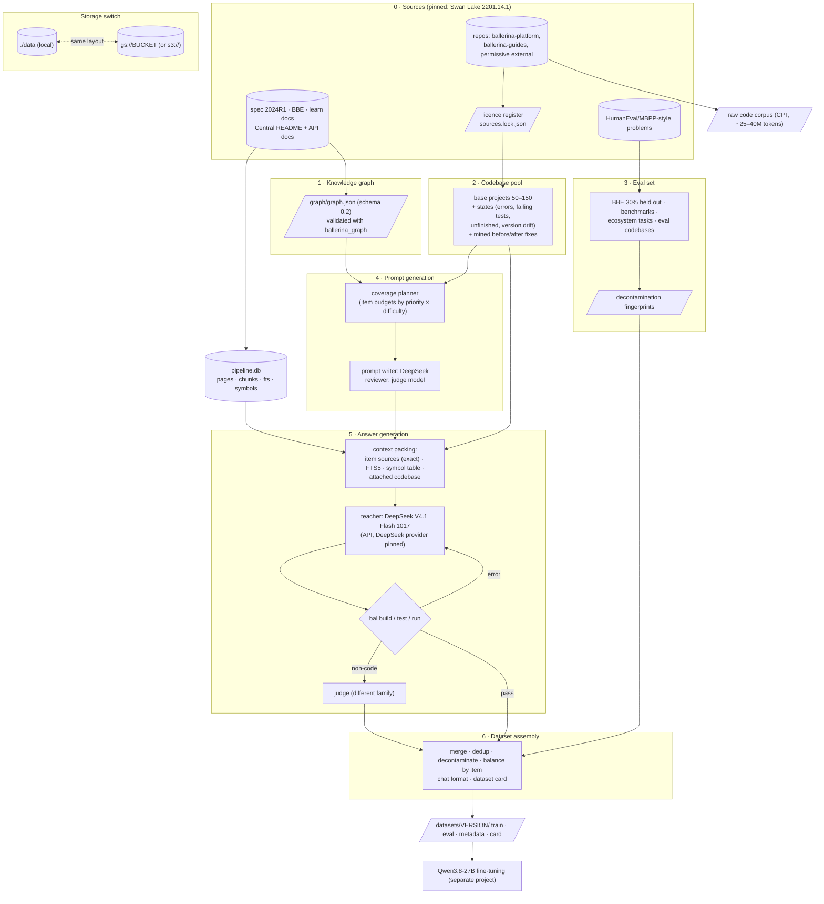

# Ballerina SLM dataset: research and plan (v2)

Branch `feat/pipeline-plan-v2` · drafted 2026-11-16, revised 2026-11-19 with your decisions ·
status: **revised proposal, awaiting approval**. No project code was changed for this plan.

**Goal.** The final deliverable is **SFT datasets for fine-tuning
[`Qwen/Qwen3.8-27B`](https://huggingface.co/Qwen/Qwen3.8-27B)**, plus everything needed to
make and judge them well, all built in this project:
- the evaluation set and decontamination list
- the codebase pool
- the raw pretraining corpus

Training and deployment (design phases 7–9) are out of scope. They appear here only where
they constrain the dataset: chat format, context length, evaluation split and
decontamination.

### Decisions (2026-11-19)

| Topic | Decision | Effect on the plan |
|---|---|---|
| Prompt writer | **DeepSeek V4.1 Flash 1017 writes the prompts.** A judge model of a different family reviews them. Claude is not used to produce dataset content. | The Anthropic "competing models" question no longer applies to the data (§2.0). Prompt writing costs about $5–10. |
| BBE examples | **Split 30% eval / 70% train, by example.** A deterministic hash of the example name decides the side. | The eval set holds ~180 runnable examples with `.out` files. Fingerprints keep near-copies of them out of training (M4). |
| Student deployment | **Server**: Qwen3.8-27B on GPUs (vLLM) | Context packing budget up to **~16k tokens** per sample. The dataset follows Qwen3.8's own chat template (§2.0). |
| Scope | **Build here:** eval set, codebase pool, raw pretraining corpus, and **include permissive external repos** | Milestones M4, M7 and M9 are firm, not optional. The corpus target is ~25–40M tokens (§2.A). |

**Contents**

1. [Current state of the repo](#1-current-state-of-the-repo)
2. [Research findings](#2-research-findings)
3. [Target architecture](#3-target-architecture)
4. [Storage switch design](#4-storage-switch-design)
5. [Folder structure and module changes](#5-folder-structure-and-module-changes)
6. [Implementation plan](#6-implementation-plan-smallest-useful-milestone-first)
7. [Cost estimate](#7-cost-estimate)
8. [Risks and open questions](#8-risks-and-open-questions)

---

## 1. Current state of the repo

### 1.1 What exists today (v2.1, branch `feat/sqlite-qa-pipeline`, commit `58b7d23`)

The repo has a **source-driven Q&A generator**. Its main pieces:
- **Commands:** `sftgen scrape`, `generate-questions`, `generate-answers`, `validate`,
  `export`, `export-sft`, `report`, `run-all`.
- **Storage:** everything is tracked in `data/pipeline.db` (SQLite), with an HTML report.
- **Current data:** 401 pages, 7,682 chunks, 50 answered questions.
- **Tests:** 56.

### 1.2 Phase by phase (design doc phases 0–9)

| # | Phase | State | What exists here | What's missing |
|---|---|---|---|---|
| 0 | Sources | **Partly built** | Spec 2024R1, BBE (from `ballerina-distribution`), learn docs, Central README + API docs, `module-ballerina(x)-*` READMEs and `.bal` APIs; robots.txt, caching, change detection | **Not pinned**: BBE comes from the default branch head and Central from the latest package versions. No licence register beyond a per-page `license` column. No raw code corpus. No benchmark problems. |
| 1 | Knowledge graph | **Present, not integrated** | `graph/graph.json` (untracked) | No loader, validation or tagging; nothing in the code reads it. Questions carry `category`/`difficulty` but no `node#item` |
| 2 | Codebase pool | **Missing** | — | Projects, states, commit miner, tagger, verification, split |
| 3 | Evaluation set | **Missing** | `export-sft` holds out ~5% of pages | Benchmarks, ecosystem tasks, eval runner, **decontamination list** |
| 4 | Prompt generation | **Partly (different approach)** | Questions are generated **per chunk** (source-driven), round-robin by source, with near-duplicates skipped | Coverage-driven planner per graph item, item budgets, codebase attachment, writer/reviewer, pilot/gap-fill |
| 5 | Answer generation | **Partly** | Teacher answers from question + chunk (OpenRouter); `bal build` check; citation | Context packing for codebases, `bal test`/`bal run`, **repair loop with real errors**, judge for non-code answers, preference pairs, answer-format contract |
| 6 | Dataset assembly | **Partly** | `export` (review JSONL), `export-sft` (chat `messages`, split by page, `Source:` stripped) | Balancing by item/task/difficulty, decontamination, dataset cards, `covers` tags |
| 7–9 | Training, evaluation, deployment | Out of scope | — | — |

### 1.3 The knowledge graph

**Where it lives and what it contains.**
- **Here:** `graph/graph.json` (3.0 MB, untracked).
- **Upstream:** it's the `build/graph.json` export of
  [ballerina-ecosystem](https://github.com/sajith-jeewantha/ballerina-ecosystem) at `64c8d80`
  (2026-11-02, "ballerina-graph.v3/complete"). It is **byte-identical** to that export (checked).
- **Contents:** 242 nodes (71 library, 69 connector, 51 concept, 27 tool, 14 topic, 6 trigger,
  4 platform), 1,704 edges (1,487 `uses`), and 3,257 must-cover items.
  - Difficulty per item: 2,047 intermediate, 1,101 beginner, 737 advanced. Items can carry
    several levels.
  - Priority: 43 core nodes (676 items), 107 important (1,559 items), 92 long-tail (1,022 items).

**Schema.** The schema is `0.2` (`ballerina_graph/models.py`); "v2/v3" are names of data
releases, not schema versions.
- Every node matches the schema.
- Running upstream's validator myself gives
  `OK: 242 nodes, 3257 items, 1704 edges, 0 warning(s)`.

**How it's loaded and validated (upstream only).**
- Loading: `python -m ballerina_graph {validate,export,view,stats,serve}`.
- Pydantic models are frozen and forbid extra fields.
- Graph checks: id prefixes, unique ids, edge targets, `via`/`target_items` resolve, no
  `requires` cycles, deprecated nodes need `replaced_by`.
- `Graph.iter_items()` / `ref()` produce the `node#item` ids the dataset should use as `covers`.
- **This repo doesn't load or validate the graph at all.**

### 1.4 Broken, duplicated or inconsistent

1. **The design doc is out of date.**
   - It says 72 nodes / 396 items; the graph has 242 / 3,257.
   - It marks these as **built**: the coverage planner, codebase matching, the
     `prompt-writer`/`prompt-reviewer` agents, merge/dedup, and `codebases`
     validate/materialize/verify. **None of them exist** in `ballerina-ecosystem`, this repo,
     `ballerina-sft-forge` or `ballerina-corpus-collector`. Either another team has them, or
     they are not written yet. **Decided 2026-11-19: this project builds them** (M5, M7, M8).
2. **The graph's sources aren't pinned.**
   - 693 Central links use `/latest`.
   - 723 GitHub links point at `master`/`main`; only 35 point at tags.
   - This conflicts with "pinned snapshots".
3. **1,100 of 3,257 items (34%) have no sources of their own.** They fall back to the
   node's sources (`sources_for`). This includes 251 items on **core** nodes.
4. **Two taxonomies.**
   - The Q&A pipeline's `category` (concept, syntax, …) is unrelated to graph items.
   - Graph difficulty is a list; questions have a single difficulty.
5. **Two "eval" notions.** `export-sft` splits by source page, while the design wants a
   separate evaluation suite and a decontamination list. BBE examples are currently used
   for **training** even though they are the most eval-like content (runnable, with
   `.out` files).
6. **The upstream graph docs are stale.** The `ballerina-graph` README says "v0.1" and has a
   placeholder install URL; `prompt.md` still says `schema_version: "0.1"`. There are no
   tests in `ballerina-ecosystem`.
7. **Uncommitted files in this repo.** `idea/` is newly gitignored (uncommitted change) and
   `graph/` is untracked. A scratch `test.py` that used the `openrouter` SDK (not a
   dependency) has since been deleted.

---

## 2. Research findings

### 2.0 Models and licences (hard requirement)

**Teacher: `deepseek/deepseek-v4.1-flash-1017`.**
- **Status: ALLOWED, with one condition.**
- **Weights:** [`deepseek-ai/DeepSeek-V4.1-Flash-1017`](https://huggingface.co/deepseek-ai/DeepSeek-V4.1-Flash-1017),
  MIT licence (checked: `license: mit`). It's a large MoE: the card says 552B backbone, about
  8–16B active per token, 1M context.
- **DeepSeek terms of use**
  ([§4.2](https://cdn.deepseek.com/policies/en-US/deepseek-terms-of-use.html), checked
  against the source):
  > "You may apply the Inputs and Outputs of the Services to a wide range of use cases,
  > including … training other models (such as model distillation), etc., as long as such
  > usage is legal and adhere to these Terms."
- **The condition:** OpenRouter routes this model to about 38 hosts. Requests served by
  hosts other than DeepSeek fall under those hosts' terms, while
  [OpenRouter's terms](https://openrouter.ai/terms) §6.1 defer to each model's terms.
  - **Pin the provider:** `provider.order=["DeepSeek"]`, `allow_fallbacks=false`.
  - Keep OpenRouter prompt logging off (§6.2 lets OpenRouter license anonymised user
    content).
- **Recommendation:** keep DeepSeek V4.1 Flash 1017 as the teacher, called through the
  **API with the DeepSeek provider pinned**, not self-hosted (see §7). Re-check the LICENSE
  and terms on the day the full run starts and save copies in `data/licences/`.

**Student: `qwen/qwen3.8-27b`.**
- **Status: ALLOWED with Apache-2.0 notice duties.**
- [`Qwen/Qwen3.8-27B`](https://huggingface.co/Qwen/Qwen3.8-27B) is a 27B dense model with
  262k native context under Apache-2.0 (§2 grants derivative works; §4 requires keeping the
  licence and NOTICE and marking changes). There is no naming requirement.
- **Don't confuse it with the flagship** Qwen3.8 Max licence (revenue condition); that one
  doesn't apply to the 27B.
- **Deployment fit:** 4-bit weights are about 16–17 GB, which fits a 32 GB+ Mac or a 24 GB
  GPU, but it's slow for in-editor completion.
- **Decision: served on a GPU server.** This is a good fit for a 27B dense model, and the
  context budget can be generous (up to ~16k tokens of packed project code per sample).
- **Chat template:** export `messages` and let training apply `Qwen/Qwen3.8-27B`'s own
  tokenizer chat template, so the format at inference matches.
- **Thinking mode:** Qwen3-family post-trained models support a thinking/non-thinking switch.
  Before M8, check how Qwen3.8's template handles it, and decide whether samples carry
  reasoning or train the non-thinking mode only. That's an open question, §8.

**Claude-written prompts.**
- **Status: UNCLEAR.**
- [Anthropic Commercial Terms](https://www.anthropic.com/legal/commercial-terms) §D.4 bars
  using the services "to train competing AI models … except as expressly approved by
  Anthropic". Prompts written by Claude are Claude outputs.
- Whether a narrow Ballerina coding model is "competing" isn't defined.
- **Decision:** DeepSeek writes the prompts, so no Claude output enters the dataset, which
  avoids the question. Claude stays a development tool for this codebase only (writing
  pipeline code), which doesn't make its outputs training data.

### 2.A Ballerina code at scale

**What exists (GitHub API, 2026-11-16; seed register in
[`docs/licence-register.csv`](licence-register.csv)).**
- **`ballerina-platform`:** 488 public repos, 0 archived; **484 Apache-2.0**, 2 with no
  licence (`blog`, `ballerina-platform.github.io`), and 2 NOASSERTION (`ballerina-spec`,
  `module-ballerina-mqtt`; the licence file needs a manual check). 9.0 GB in total, but
  that's git size, mostly website assets.
  - 366 `module-ballerinax-*`
  - 70 `module-ballerina-*`
  - 20 codegen tools
  - 6 core repos
- **`ballerina-guides`:** 15 repos, reported Apache-2.0: integration-tutorials/samples,
  ai/healthcare/etl/b2b samples, `gcp-microservices-demo`, `social-media-demo`,
  `ftgo-microservices-example`, `training-content`.
- **Outside these orgs:** `language:Ballerina` returns 5,553 repos. Of the top 100, **47 have
  no licence**. About 503 are Apache-2.0 and 100 MIT. Roughly 3,787 were pushed after 2023;
  the rest are probably 1.x syntax.
- **[The Stack v2](https://huggingface.co/datasets/bigcode/the-stack-v2)** has a Ballerina
  subset, but it is gated, has to be fetched from Software Heritage, and reportedly mixes in
  unlicensed files. **Apply our own licence filter.**

**Which repos are worth what.**

| Purpose | Best sources | Notes |
|---|---|---|
| **Evaluation (keep out of training)** | **30% of** `ballerina-distribution/examples` (766 `.bal` + 766 `.out` in total), held-out codebases from the pool | **Decided: split 30/70 by example.** The eval 30% is fingerprinted and its near-copies are removed from every training corpus, including the ballerina.io page copies and the raw corpus. |
| **Codebase pool (50–150 projects)** | `ballerina-guides/*` (multi-module services, tutorials), `wso2/open-healthcare-prebuilt-services`, `wso2/people-ops-suite`, `ballerina-library`, licensed external Swan Lake projects | Keep `Ballerina.toml` projects with `distribution = "2201.*"` that pass `bal build` with the pinned toolchain |
| **Commit-history mining** | `module-ballerina-*` (idiomatic code + tests), guides repos | Use commits touching both `src` and tests; skip bumps, bots and regenerations |
| **Error-fixing material** | `ballerina-lang` negative tests (774) + parser/formatter before/after pairs | 8,636 `.bal` files; skip the ~107 MB of synthetic giant test files |
| **Raw pretraining corpus (optional)** | All of the above after dedup | **Down-weight generated code**: `openapi-connectors` (1,114 files, 0 tests) and most `ballerinax` connector `client.bal`/`types.bal` |
| **RAG / grounding** | Central API docs, spec, learn docs (already in `pipeline.db`), module READMEs | Exact lookup by graph item source, see §2.B |

**How to collect.**
- **Snapshots:** `git clone --filter=blob:none --sparse`, then
  `git sparse-checkout set --no-cone '*.bal' 'Ballerina.toml' '*.out' 'README.md'`. This
  fetches only those blobs (about 0.3 GB for the org), unlike a full clone (9 GB) or the
  per-file API (60/5,000 requests an hour).
- **History mining:** a full-history blobless clone plus `git log -p --no-merges -- '*.bal'`,
  restricted by path for `ballerina-lang`.
- **Pinning:** a `sources.lock.json` with, per repo: URL, commit SHA, SPDX licence, licence
  file hash, fetch date and file count. The **Swan Lake pin is 2201.14.1** (Update 14; your
  local `bal`, and the latest on ballerina.io). BBE is pinned to the matching
  `ballerina-distribution` tag; Central to the package versions that ship with or support it.
- **Filtering:** keep `distribution = "2201.*"`. Drop 1.x syntax (`endpoint`, `but {`, no
  distribution key). Spot-check with `bal build`.
- **Dedup:** exact SHA-256 on normalised text, then MinHash LSH (5-gram, Jaccard 0.8), then
  detect generated code (header, OpenAPI spec present, type density).

**Estimated size.**

| Scope | `.bal` files | Size | Tokens |
|---|---|---|---|
| ballerina-platform + guides, raw | ~22–30k | ~0.25–0.4 GB | ~60–100M |
| after dedup and dropping generated code | ~12–15k | ~60–100 MB | ~15–25M |
| + permissive external repos | +8–15k usable | +30–60 MB | +8–15M |
| **Usable total** | **~30–40k** | **~0.15–0.2 GB** | **~25–40M** |

**Recommendation:**
- Collect with blobless sparse clones pinned in a lockfile.
- Licence-gate every repo through the register.
- Split the BBE examples **30% eval / 70% train**, by example.
- Build the codebase pool from `ballerina-guides` and wso2 projects first, then add external
  Apache/MIT Swan Lake projects to reach 50–150. External repos are in scope.

**Answer to "should I download lots of sample projects and put them in a vector DB?"**
**No.**
- Projects go into the **codebase pool** as files, a manifest and verified states, tagged with
  the graph items they use (from imports → `modules` → nodes).
- Prompts get code attached by **graph item match**, not by vector similarity.
- A vector index adds nothing there; at most it helps pick few-shot examples (§2.B).

### 2.B Vector DB and RAG: worth it?

**Where it helps and where it doesn't.**

| Use | Helps? | Best mechanism |
|---|---|---|
| Ground a prompt or answer in the right spec, BBE or docs page for a graph item | **Yes** | **Exact lookup**: each item already lists its source URLs. Match them to `pages`/`chunks` rows. For items without sources, use the node's sources plus **SQLite FTS5 (BM25)** on the item text |
| Give the teacher exact API signatures | **Yes** | **Symbol table** from the Central docs API (already scraped), looked up by `module:symbol`. No embeddings |
| Codebase matching | Not via vectors | Graph tags (imports → modules → nodes; `uses`/`requires` edges) |
| Similar code examples / few-shot selection | Maybe | BM25 first; dense retrieval only if it measurably raises compile/pass rate |
| Answers that span sections (currently a weakness) | Yes | Item sources + FTS5 neighbours, 1–2 extra chunks |

**Evidence.**
- Retrieving docs and examples together helps low-resource languages
  ([RAR, EMNLP 2024](https://aclanthology.org/2024.emnlp-main.1199): +2.8–26%).
- For code→code retrieval, word-split BM25 matched or beat dense retrievers and ran about 10×
  faster ([arXiv 2510.20609](https://arxiv.org/pdf/2510.20609)).
- No embedding model was trained on Ballerina.

**Options at our scale** (50k–500k chunks; about 1.5 GB of 768-d vectors at the top end):
- **SQLite FTS5 + sqlite-vec:** runs in-process, zero ops, inside the existing
  `pipeline.db`; hybrid search via RRF. sqlite-vec is still pre-1.0.
- **LanceDB:** embedded, can live in a bucket.
- **Chroma:** what we just removed.
- **Qdrant and pgvector:** each is a service to run.
- **Vertex AI Vector Search:** at least about **$68/month per always-on node** plus $3/GiB
  per index build ([pricing](https://cloud.google.com/vertex-ai/pricing)). No benefit at this
  size.

**Embeddings and chunking, if they're ever needed.**
- [`jina-embeddings-v2-base-code`](https://huggingface.co/jinaai/jina-embeddings-v2-base-code)
  (Apache-2.0, 161M, 8k context) runs locally. Compare it with voyage-code-3 ($0.18/M) on
  about 100 Ballerina queries.
- Chunk code by declaration with
  [tree-sitter-ballerina](https://github.com/heshanpadmasiri/tree-sitter-ballerina) (MIT).
  Its Swan Lake coverage is partial, so fall back to the existing brace-aware splitter.

**Recommendation: no vector database.**
- Use exact item→source lookup, a Central symbol table and SQLite FTS5, all inside
  `pipeline.db`.
- Add sqlite-vec embeddings later, and only for few-shot selection, if a measured A/B shows a
  gain.

### 2.C Cloud storage: GCS vs AWS S3

| Item (list prices, 2026-11-16) | GCS (us-central1) | S3 (us-east-1) |
|---|---|---|
| Standard storage | $0.020/GB-month | $0.023/GB-month |
| Writes / reads | $0.005 / $0.0004 per 1k | $0.005 / $0.0004 per 1k |
| Internet egress (incl. RunPod/Lambda/Modal) | $0.12/GB (100 GB/month free) | $0.09/GB (100 GB/month free) |
| Same-cloud transfer | free | free |

Sources: [GCS pricing](https://cloud.google.com/storage/pricing), [S3 pricing](https://aws.amazon.com/s3/pricing/).
The S3 egress and request rates were read from third-party summaries (see the caveat in §8).

**Expected size and cost.**
- **Size:** about 0.3 GB of code snapshots, 1–5 GB of codebase states, under 2 GB of
  prompts, answers and datasets, plus `pipeline.db`. That's **10–30 GB**, or 50 GB with
  history clones and caches.
- **Monthly cost at 50 GB with sharded files** (large JSONL/zstd shards, not millions of small
  objects):
  - **About $1–3** with no egress. With the teacher on an API, nothing is read out to GPUs.
  - **About $8–20** if 200 GB a month is read by third-party GPUs for training (later
    project).
- **Request charges outweigh storage** unless files are sharded.

**Recommendation: GCS.**
- At this volume the price difference is a few dollars a month.
- Authentication with ADC (`gcloud auth application-default login`) is the simplest no-secret
  setup.
- The earlier pipeline already had a GCS mirror, and GCP has GPUs and TPUs for training in the
  same region with free egress.
- **Choose S3 instead if training will run on AWS.**
- **Cloudflare R2** (zero egress, $0.015/GB) is worth knowing about if training will run on
  third-party GPUs. It works through the same S3 code path with an endpoint URL, so the
  design keeps that option open.

---

## 3. Target architecture



**Decisions shown in the diagram:**
- There's no vector database. Retrieval is exact item→source lookup plus FTS5 and a symbol
  table inside `pipeline.db`.
- The toolchain is the judge for code; an LLM judge only checks non-code answers.
- BBE is split 30% eval / 70% train.
- One storage layout everywhere.

---

## 4. Storage switch design

### 4.1 `.env`

```env
# --- storage ---
STORAGE_BUCKET=false        # false = save locally only (testing, quality checks)
                            # true  = also save to the cloud bucket (same layout)
STORAGE_PROVIDER=gcs        # gcs | aws-s3
BUCKET_NAME=                # e.g. ballerina-slm-data
BUCKET_PREFIX=              # optional sub-folder in the bucket, e.g. team-a/
LOCAL_DATA_DIR=./data

# GCS auth: run `gcloud auth application-default login` (ADC). No key in .env.
# AWS auth: set AWS_PROFILE (from ~/.aws/credentials) and AWS_REGION. No keys in .env.
# S3-compatible (e.g. Cloudflare R2): STORAGE_PROVIDER=aws-s3 plus S3_ENDPOINT_URL=...
AWS_PROFILE=
AWS_REGION=
S3_ENDPOINT_URL=
```

### 4.2 How it works

- **Module:** `shared/balpipe_common/storage.py`, built on
  [fsspec](https://filesystem-spec.readthedocs.io/) (`gcsfs` / `s3fs` as optional extras).
  - Everything addresses **relative paths** such as `datasets/v1/train.jsonl`.
  - The module resolves them to `LOCAL_DATA_DIR/...` or `gs://BUCKET/PREFIX/...`.
- **API:** `open(rel, mode)`, `exists`, `list(prefix)`, `put(local, rel)`, `get(rel, local)`,
  `url(rel)`.
- **The working copy is always local.** SQLite and `bal build` need a real disk.
- **With `STORAGE_BUCKET=true`:**
  - Each command **pulls** the inputs it needs that are missing locally.
  - After it succeeds, it **pushes** its new outputs (content-hashed, skipped if already
    present).
  - `pipeline.db` is pushed as a snapshot (`db/pipeline-<run_id>.db`) after each command,
    never edited in place in the bucket.
- **Switching is one flag:** the layout below is identical in both places. `sftgen storage
  status` would show what's local only or remote only.
- **Shard outputs** into large JSONL.zst / tar.zst files, because request charges dominate
  costs at this size.
- **Never synced:** `cache/` and `.env`. Secrets stay in ADC or AWS profiles.
  `.gitignore` already covers `.env` and `data/`.

### 4.3 Artifacts and where they go

| Artifact | Path (local = bucket) | Local | Bucket (when on) |
|---|---|---|---|
| Pinned docs snapshots + lockfile | `sources/2201.14.1/…`, `sources/sources.lock.json` | ✓ | ✓ |
| Licence register + licence texts | `licences/register.csv`, `licences/texts/…` | ✓ | ✓ |
| Raw repo snapshots (sparse) | `repos/<owner>__<repo>@<sha>.tar.zst` | ✓ | ✓ |
| Raw code corpus | `corpus/raw-<version>/part-*.jsonl.zst` | ✓ | ✓ |
| Knowledge graph copy | `graph/<graph_sha>/graph.json` | ✓ | ✓ |
| Codebase pool: base + states | `codebases/<id>/base.tar.zst`, `codebases/<id>/states/<state>.patch`, `codebases/manifest.jsonl` | ✓ | ✓ |
| Eval suite + decontamination | `eval/<version>/…`, `eval/<version>/decontam.jsonl` | ✓ | ✓ (restricted access) |
| Prompts (plans, accepted, rejected, coverage) | `prompts/<run>/…` | ✓ | ✓ |
| Answers, attempts, preference pairs | `answers/<run>/…` | ✓ | ✓ |
| Final datasets + cards | `datasets/<version>/{train,eval,metadata}.jsonl, CARD.md` | ✓ | ✓ |
| Pipeline database | `db/pipeline.db` (+ snapshots) | ✓ working copy | snapshots only |
| Reports | `reports/report.html` | ✓ | ✓ |
| Checkpoints | `checkpoints/…` (training project) | — | ✓ (training project writes here) |
| Caches (HTTP, LLM, bal) | `cache/…` | ✓ | ✗ never |

---

## 5. Folder structure and module changes

The current three-package structure stays. New pieces are additions; nothing from v2.1 is
removed. (`data/` keeps the layout from §4.3.)

```
graph/graph.json                    # tracked; pinned to ballerina-ecosystem@<sha> in graph/SOURCE
shared/balpipe_common/
  storage.py                        # NEW: local/GCS/S3 switch (fsspec)
  graph.py                          # NEW: load + validate graph.json with ballerina_graph
                                    #      (pinned dependency), item refs node#item
  licences.py                       # NEW: register read/write, SPDX allowlist gate
scraper/ballerinascraper/
  collectors/                       # + pin to sources.lock.json (BBE tag, Central versions)
  repos.py                          # NEW: blobless sparse clones, lockfile, Swan Lake filter
sft-dataset-generator/src/sftgen/
  graph/      coverage.py · tagger.py      # NEW: map pages/chunks/questions → items; coverage report
  retrieval/  fts.py · symbols.py          # NEW: FTS5 index, Central symbol table
  codebases/  manifest.py · states.py · miner.py · verify.py   # NEW (or reuse other team's tooling)
  eval/       bbe_holdout.py · decontam.py # NEW
  plan/       planner.py · budgets.py      # NEW: item budgets, prompt specs
  generate/   prompts.py (writer/reviewer) · answers.py (+ repair loop, judge, pairs)
  assemble/   balance.py · card.py         # NEW; export-sft becomes part of this
docs/PLAN.md · docs/licence-register.csv
```

**Data model additions (SQLite):**
- New tables: `graph_items`, `item_sources`, `prompts`, `attempts`, `codebases`,
  `codebase_states`, `eval_items` and `fingerprints`.
- Each prompt and sample gets a `covers` field (`node#item` list).

**Dependency.** Install `ballerina-graph` from
`git+https://github.com/sajith-jeewantha/ballerina-ecosystem@64c8d80#subdirectory=ballerina-graph`
instead of copying its code, so the schema has one owner.

---

## 6. Implementation plan (smallest useful milestone first)

Each milestone ends with something you can run and check locally (`STORAGE_BUCKET=false`).

| M | Milestone | Delivers | Test locally |
|---|---|---|---|
| **M0** ✅ | Hygiene and pinning | Commit `graph/` and the `.gitignore` change. Add `sources.lock.json` (Swan Lake 2201.14.1), pin BBE to the distribution tag, set the OpenRouter provider pin for the teacher | `sftgen scrape --refresh` shows pinned versions in the report |
| **M1** ✅ | Graph integration + coverage | `graph.py` loader and validator, `sftgen graph validate/stats`, item↔page matching from source URLs, and a **coverage section in the report** (items with or without grounding and samples) | `sftgen graph validate` → `OK 242/3257/1704`; the report shows coverage per node and priority |
| **M2** | Storage switch | `storage.py`, `.env` keys, push and pull after each command | Run with `false`, then `true` against a test bucket: identical layout |
| **M3** | Licence register + repo collector | `sftgen collect-repos`: sparse, pinned, licence-gated, Swan Lake filter, dedup. It covers ballerina-platform, ballerina-guides, wso2 and **permissive external repos**, and keeps the register CSV up to date | Collect `ballerina-guides` (15 repos), then 20 external repos; counts and licences in the report |
| **M4** | Eval set v1 + decontamination | **BBE 30/70 split** by example; eval items tagged `node#item`; fingerprints (exact + MinHash); near-copy removal in every export | Export shows 0 rows overlapping eval; ~180 BBE eval items each pass `bal run` against their `.out` |
| **M5** | Item-driven prompts (**pilot**) | Planner with budgets by priority × difficulty. **DeepSeek writes, the judge model reviews.** Grounding comes from item sources, FTS5 and the Central symbol table | **~900 prompts on the HTTP cluster**; read 100 samples in the report |
| **M6** | Verified answers | Repair loop with real `bal` errors (up to 3 tries), `bal test` where tests exist, judge for non-code answers, attempt and preference-pair records, answer-format contract (§8, question 1) | Pass rate, repair rate and cost per phase in the report |
| **M7** | Codebase pool v1 | 20 projects → states (compile error, failing test, unfinished feature, version drift) → verify → tag with graph items → attach to prompts. Context packing up to ~16k tokens | `sftgen codebases verify` all green; prompts with attached code |
| **M8** | Eval set v2 + baselines | Ballerina translations of HumanEval/MBPP-style problems (tests checked with `bal test`); ecosystem tasks per core node; fix/extend/explain tasks on **eval-split codebases**; an eval runner (pass@k with `bal build/test`, judge for prose); baselines for **base Qwen3.8-27B** and the teacher | Per-item baseline score map in the report; this tells you later whether the dataset helped |
| **M9** | Pool to 50–150 + commit miner + raw corpus | Scale the pool with external repos; mined before/after fixes; **raw pretraining corpus** (~25–40M tokens, generated code down-weighted, eval fingerprints removed) | Counts, licences and token totals in the register and report |
| **M10** | Assembly + full run → **dataset v1** | ~6,000 prompts plus gap-fill until items reach budget; balance by item, task, difficulty and context mode; dedup; decontaminate. Outputs in Qwen3.8 chat `messages`: **SFT train/eval**, optional **DPO pairs**, **CPT corpus**, and a dataset card; pushed to the bucket | `datasets/v1/` with a card listing coverage per item, licences and the graph version |

**Done (2026-11-19):** M0 and M1 are built and tested; see CHANGELOG "Unreleased".
- With the current database, 1,227 of 3,231 active items are grounded (core: 412 of 676).
- Most of the rest are only "not scraped yet", which more scraping (M3) closes.

M1 and M2 can run in parallel, and so can M3 and M4. M5 is the first point that costs model
money. The full run (M10) comes after the pool (M9), so most prompts can carry real code.

---

## 7. Cost estimate

| Item | Assumption | Estimate |
|---|---|---|
| Teacher, pilot (M5–M6) | 900 prompts × ~1.6 calls (repairs), ~6k in / 1.5k out tokens, DeepSeek V4.1 Flash 1017 at $0.15 / $0.60 per M (OpenRouter list, 2026-11-13) | **~$2–4** |
| Teacher, full run | 6,000 prompts, same assumptions → ~58M in / 14M out | **~$17**, budget **$30–50** with gap-fill and longer codebase context |
| Self-hosting the teacher instead (vLLM) | 552B+ MoE needs ~8× H100-class GPUs (~$16–25/hour) | **Not worth it** at this volume. The API is cheaper by orders of magnitude |
| Judge (non-code answers, ~30%) | Small model of a different family, e.g. qwen3.8-flash at $0.15 / $0.47 | **< $3** |
| Prompt writing (decided: DeepSeek) + review (judge model) | 6,000 prompts + gap-fill; ~3k in / 0.5k out each, plus a short review call | **~$5–10** |
| Eval set build + baselines (M8) | Benchmark translation by the teacher with repairs (~400 problems); baselines: base Qwen3.8-27B ($0.15 / $1.88 per M) and the teacher on ~1,000 eval tasks × pass@5 | **~$15–25** |
| Storage | 10–50 GB, sharded, teacher via API | **~$1–3/month** (GCS); ~$8–20/month only if GPUs elsewhere read 200 GB/month |
| `bal` verification | Local CPU | $0 (laptop heat; workers = 2) |
| Training compute (separate project, for budgeting) | QLoRA on the 27B student, ~15–25M tokens × 2–3 epochs on 1× H100 80 GB (~$2.5–3.5/hour) | **~$20–60 per run**. Full fine-tuning of the 27B needs 8× H100: ~$200+ per run. Optional continued pretraining on the 25–40M token corpus: a similar order |

**Total for the dataset project:** about **$60–100** in model calls (pilot, full run, eval
build and baselines), plus about $1–3/month for storage, with the teacher on the API and
DeepSeek writing the prompts.

---

## 8. Risks and open questions

**Questions for you** (remaining after the 2026-11-19 decisions):

1. **Answer format for codebase tasks.** Recommendation: **the full content of each changed
   file**, under a path header. This is easier to apply and verify than unified diffs, and it
   fits in the ~16k server context. Diffs only for files over about 400 lines. Needed before
   M6.
2. **Thinking mode.** Train Qwen3.8-27B's **non-thinking** mode only (answers without
   reasoning traces), or include short reasoning? Recommendation: non-thinking for v1, which
   is cheaper and matches an editor assistant. Check how Qwen3.8's chat template handles the
   switch before M10.
3. **Training cloud.** GCP, AWS or third-party GPUs? This decides GCS (the default), S3 or R2
   for the bucket. It doesn't block anything before M2.
4. **Benchmark licences.** HumanEval-style problems are usually MIT and MBPP-style CC-BY-4.0;
   verify both in M8 before translating. Or should we write our own problems only?
5. **Upstream graph fixes.** Should the 251 core items without their own sources, and the
   `/latest` and `main` links, be fixed upstream in `ballerina-ecosystem` (the graph team), or
   should this project resolve them locally in `sources.lock.json` and leave the graph as is?
   Recommendation: resolve them locally now and report the list upstream.

**Risks:**

- **Licence drift:** the terms of the teacher or a repo may change. Mitigation: snapshot the
  licence texts with dates in `licences/`, and re-check before each full run.
- **Provider routing:** OpenRouter may serve requests from non-DeepSeek hosts unless they are
  pinned. Mitigation: provider pin with fallbacks disabled.
- **Version drift:** the graph's Central `/latest` and GitHub `main` links will drift.
  Mitigation: resolve them to pinned versions in `sources.lock.json` in M0.
- **Contamination:** BBE and docs are on the public web, so Qwen3.8-27B may already have seen
  the eval BBE 30%. Mitigation: weight the score on the held-out codebases and newly
  translated benchmarks, and compare against the base-model baseline (M8), not raw scores.
- **External repos:** licences can be wrong or missing in metadata. Mitigation: read the
  LICENSE file itself, keep NOTICE files, and record each repo in the register before any
  file enters the pool or the corpus.
- **Coverage blind spots:** 34% of items lack sources of their own, so grounding falls back
  to node sources. Mitigation: show them in the coverage report and prioritise the 251 core
  items for upstream source work.
- **Generated code dominating the corpus:** OpenAPI connectors. Mitigation: detect and
  down-weight.
- **Toolchain cost:** `bal` builds are slow (1–6 s, JVM). Mitigation: cache, offline builds,
  2–4 workers. A full run means hours of CPU.
- **Research caveats:**
  - The S3 egress and request rates came from third-party summaries, because AWS's tables
    didn't render.
  - tree-sitter-ballerina's Swan Lake coverage is unverified.
  - The DeepSeek card reports 552B parameters but the HF metadata says 763B.
  - The licence verdicts are not legal advice.
