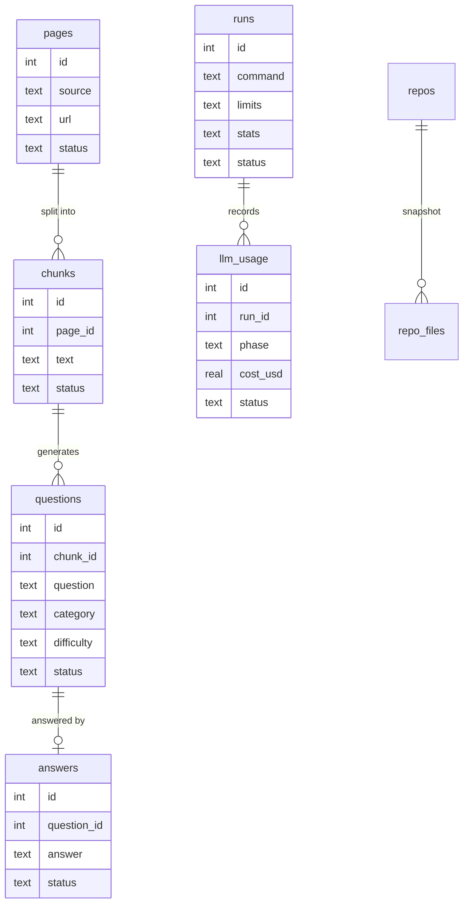

# Data model: `data/pipeline.db`

One SQLite file holds everything the pipeline produces. Every table has an integer `id`, a
`status`, and `created_at` / `updated_at` timestamps (UTC, ISO 8601). The schema is created
automatically on first use (`shared/balpipe_common/db.py`).



---

## `pages`

One row per source page or file.

| Column | Meaning |
|---|---|
| `source` | `bbe` · `spec` · `learn` · `central` · `github` |
| `url` | Public URL (unique). Cited in answers. BBE uses the ballerina.io page URL even though content comes from GitHub. |
| `fetch_url` | What was actually requested (GitHub folder, docs API URL, page URL) |
| `title` | Page title after cleaning |
| `status` | `fetched` (raw stored, not processed yet) · `chunked` · `empty` (no usable content) · `duplicate` (same clean content as another page) · `blocked` (robots.txt) · `failed` |
| `error` | Why it failed, was empty, or is a duplicate |
| `http_status`, `etag`, `last_modified` | Last response; used for conditional GETs |
| `version_key` | Blob SHA(s) or package version. When it is unchanged, the page is skipped without a download. |
| `raw_body`, `raw_hash` | Raw cache: HTML, Markdown, a JSON bundle of BBE files, or compacted Central JSON |
| `markdown`, `content_hash` | Clean Markdown, and its whitespace-insensitive hash (used for duplicate detection) |
| `license` | SPDX id from the GitHub repo or Central package, when known |
| `meta` | JSON: repo/path, package/version, extractor used, origin |
| `fetch_count`, `last_run_id`, `fetched_at` | Fetch bookkeeping |

## `chunks`

Heading-aware pieces of a page's Markdown: the grounding for questions and answers.

| Column | Meaning |
|---|---|
| `page_id`, `source`, `source_url` | Where the chunk came from |
| `ordinal` | Position in the page |
| `heading_path` | e.g. `Ballerina Language Specification, 2024R1 > 5. Values, types and variables > 5.5 Behavioral values` |
| `text`, `text_hash` | Chunk body (code blocks are never split), and its hash. An identical body on another page is skipped. |
| `token_estimate` | Characters ÷ 4; at most `chunk.max_tokens` |
| `has_code` | 1 if the chunk contains a code block |
| `status` | `pending` (needs questions) · `questioned` · `too_small` (under `chunk.min_tokens`, not used) · `failed` (question call failed `max_chunk_attempts` times) · `stale` (no longer on the page) |
| `attempts`, `error` | Question-generation attempts and the last error |

## `questions`

| Column | Meaning |
|---|---|
| `chunk_id`, `source`, `source_url` | The chunk the question was generated from, and the URL its answer must cite |
| `question`, `question_hash` | The question, and a unique hash of its normalized text |
| `category` | `concept` · `syntax` · `library` · `tooling` · `error-fixing` · `code-writing` · `best-practice` |
| `difficulty` | `beginner` · `intermediate` · `advanced` |
| `status` | `pending` · `answered` · `failed` |
| `error` | Why answering failed |
| `model`, `run_id` | Question model and the run that created it |

## `answers`

| Column | Meaning |
|---|---|
| `question_id` | One answer per question |
| `answer` | Markdown answer, ending with `Source: <url>` |
| `model`, `run_id` | Answer model and run |
| `status` | `not_checked` · `valid` (all Ballerina blocks compiled) · `invalid` (a block failed) |
| `validation_detail` | Compiler errors (JSON) for `invalid`; otherwise the reason (`no Ballerina code`, `bal CLI not installed`, `build timed out`, `N block(s) compiled`) |

## `runs`

One row per command run (`run-all` records one per phase).

| Column | Meaning |
|---|---|
| `command` | `scrape` · `collect-repos` · `generate-questions` · `generate-answers` · `validate` · `export` |
| `status` | `running` · `succeeded` · `failed` |
| `started_at`, `finished_at`, `duration_s` | Timing |
| `limits` | JSON: `LIMIT_SCRAPE_PAGES`, `LIMIT_GENERATING`, `QUESTIONS_PER_CHUNK`, `REQUEST_DELAY_SECONDS` used |
| `stats` | JSON: items processed (pages downloaded/cached/failed, chunks new, questions saved, answers, validation counts, rows exported) |
| `error` | Exception message when the run failed |

## `llm_usage`

One row per model call.

| Column | Meaning |
|---|---|
| `run_id`, `phase`, `model` | Which run, phase (`generate-questions` / `generate-answers`) and model |
| `prompt_tokens`, `completion_tokens` | Token usage reported by the provider |
| `cost_usd` | OpenRouter's reported cost; else computed from `generate.pricing`; else `NULL`. Cached calls are `0`. |
| `cached` | 1 if served from `data/cache/llm` |
| `provider` | Host that served the call (OpenRouter's `provider` field), for licence audits: DeepSeek models are pinned to `DeepSeek` |
| `status` | `ok` · `error` |

## `graph_items`

One row per knowledge-graph item, written by `sftgen graph sync` (and after every `scrape`).
The graph comes from `graph/graph.json`; see `graph/SOURCE.json` for its upstream commit.

| Column | Meaning |
|---|---|
| `ref` | `node_id#item_id`, the id that dataset samples use in `covers` |
| `node_id`, `item_id`, `node_type`, `node_title` | Where the item sits in the graph |
| `priority` | The node's priority: `core` · `important` · `long_tail` |
| `text`, `difficulty` | The must-cover text, and its difficulty levels (JSON list) |
| `own_sources` | 0 when the item has no sources of its own and inherits its node's |
| `graph_version` | Upstream commit (12 characters) of the graph that was synced |
| `status` | `grounded` (a source is a scraped page, or a scraped spec section) · `not_scraped` (its sources can be scraped but aren't in the database yet) · `external_only` (only non-Ballerina hosts) · `retired` (deprecated node) |

## `item_sources`

One row per (item, source URL). The item's own sources are used, or the node's sources when it
has none.

| Column | Meaning |
|---|---|
| `ref`, `url`, `kind`, `note` | The graph source (`kind`: spec · bbe · central · docs · github · other) |
| `inherited` | 1 when the source comes from the node |
| `page_id` | The matching scraped page. Matching rules: ballerina.io by URL (anchor dropped); Central `/<org>/<pkg>/...` to the package page; GitHub blob to the module file (branch ignored); tree and repo links to a file below them; `ballerina-distribution/examples/<name>` to the BBE page |
| `chunk_ids` | For the spec, the chunks of the section the source points at (by its note or `#section_N.N` anchor) |
| `status` | `matched` · `not_scraped` · `external` |

## `repos`

One row per repository `collect-repos` has seen.

| Column | Meaning |
|---|---|
| `full_name`, `url` | `owner/name` and clone URL |
| `grp`, `priority` | Group from `repos.groups` (`platform` · `guides` · `wso2` · `external` · `manual`) and its order; lower wins in dedup |
| `default_branch`, `commit_sha` | Pinned commit (also in `config/sources.lock.json` under `repos`) |
| `spdx_reported`, `spdx` | Licence GitHub reports, and the licence used (read from the LICENSE file when recognised) |
| `verdict`, `licence_note` | `safe` · `check` · `exclude`, and why |
| `licence_sha256` | sha256 of the root LICENSE file |
| `stars`, `size_kb`, `pushed_at` | From GitHub |
| `files`, `bal_files` | Files in the sparse snapshot |
| `snapshot` | `repos/<owner>__<repo>@<sha12>.tar.gz` under `LOCAL_DATA_DIR` |
| `meta` | JSON: legacy, generated and too_large counts |
| `status` | `collected` (safe, files stored) · `excluded` (licence) · `licence_check` (needs a person) · `failed` (retried next run) |

## `repo_files`

One row per file in a collected repo's snapshot.

| Column | Meaning |
|---|---|
| `repo_id`, `path` | Where the file is |
| `kind` | `bal` · `toml` · `out` · `md` |
| `bytes`, `text` | Size and content (`NULL` text when over `repos.max_file_bytes`) |
| `project_root`, `distribution` | Folder of the nearest `Ballerina.toml` (`''` = repo root) and its `distribution` |
| `syntax` | `.bal` only: `swan_lake` · `legacy` (Ballerina 1.x / Swan Lake previews) · `unknown` |
| `generated` | 1 for generated code (header comments, `openapi-connectors`), to be down-weighted |
| `code_hash`, `minhash` | Fingerprints: sha256 of tokens without comments/whitespace; 128 × uint32 MinHash of 5-token shingles |
| `dup_of` | The `repo_files.id` this file duplicates |
| `status` | `kept` · `duplicate` · `near_duplicate` (MinHash ≥ `repos.near_duplicate_threshold`) · `legacy` · `too_large` · `context` (non-`.bal` files kept as project context) |

## `docs/licence-register.csv`

Tracked in git. One row per repo reviewed: `owner`, `repo`, `spdx`, `verdict`, `intended_use`,
`size_kb`, `pinned_sha`, `checked_on`, `notes`, `licence_file_sha256` and `files`. Extra columns
that people add are kept.
- A row set to `exclude` is never collected.
- `safe` with notes starting `verified:` overrides the automatic gate.

---

## `data/dataset.jsonl`

Written by `sftgen export`: one JSON object per answered question, leaving out `invalid` answers
unless `export.include_invalid` is true.

```json
{"question": "...", "answer": "...", "source_url": "https://...", "category": "code-writing", "difficulty": "beginner"}
```

## `data/sft/` (from `sftgen export-sft`)

| File | One line per | Fields |
|---|---|---|
| `train.jsonl`, `eval.jsonl` | answered question (invalid answers left out) | `id` (`q<question id>`), `messages`: optional `system`, then `user` (question) and `assistant` (answer, with the trailing `Source:` line removed when `sft.strip_source_line` is true) |
| `metadata.jsonl` | row in train or eval | `id`, `split`, `source_url`, `source`, `category`, `difficulty`, `validation` |

The split is decided by a hash of `source_url`, so all questions from one page land on the same
side.
